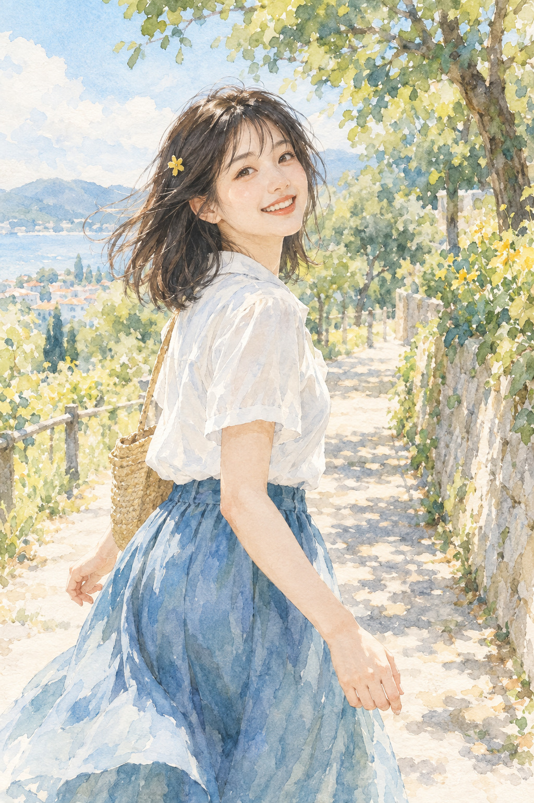

# 02 透明水彩：让纸也参与发光

这张像一封从夏天寄来的信。阳光不是特别耀眼，却仿佛能透过颜色照出来。

*图 02：模拟透明水彩与纸纹的教学插图。*

**类型：媒介效果。**真实透明水彩通过薄层颜料与纸面共同形成明亮感；此图模拟的是这种外观。材料旁读见 [S8](../editorial/SOURCES.md)。

## 顺着白衬衫看

衬衫上没有铺满统一的白色颜料效果。你看到淡蓝、浅灰与暖纸色穿插，亮处像露出了纸面。裙子上的蓝色有深浅叠加，树叶边缘则比较松散，许多小形状像是顺着水分自然散开。

“透明”可以理解为：下面一层仍参与最后的颜色。水彩中的留白常需要提前计划，因为深色铺上后，不容易完全恢复干净纸白。这个工艺特点影响了常见的画面语言，但水彩也能画得细密、鲜艳、边界锐利。

## 柔和从哪里来

本图的柔和感来自较浅的色层、边缘的虚实变化，以及背景没有处处被轮廓线封住。脸部和头发仍清楚，背景更松，所以画面既轻盈又不会失去主体。

不要把“水彩”直接等同于淡。深色水彩同样可以强烈；纸纹也不是充分条件，一张数字油画也能叠纸纹。

## 与 gouache 比

这张的蓝裙像颜色渗进纸里；gouache 那张更像一层层哑光色块盖在表面。看高光尤其有用：水彩图的亮处更像留出来，gouache 图的亮处更像画上去。生成图无法证明真实作画顺序，这只是外观上的比较。

## 两分钟练习

拿薄彩色透明纸叠在白纸上，观察一层、两层以及重叠处。没有透明纸也可以把两副浅色墨镜镜片重叠着看。练习关注“叠加”，不是复制真实水彩的化学行为。

**观察答案：**找裙子上深蓝与浅蓝交界，颜色层次和纸纹同时存在。边缘并非全模糊，人物面部仍有精确细节。

**本图兑现程度：**透明叠色、留白与晕染感较明显；脸部比背景更接近细腻数字绘画。它是一幅水彩风融合插图。
