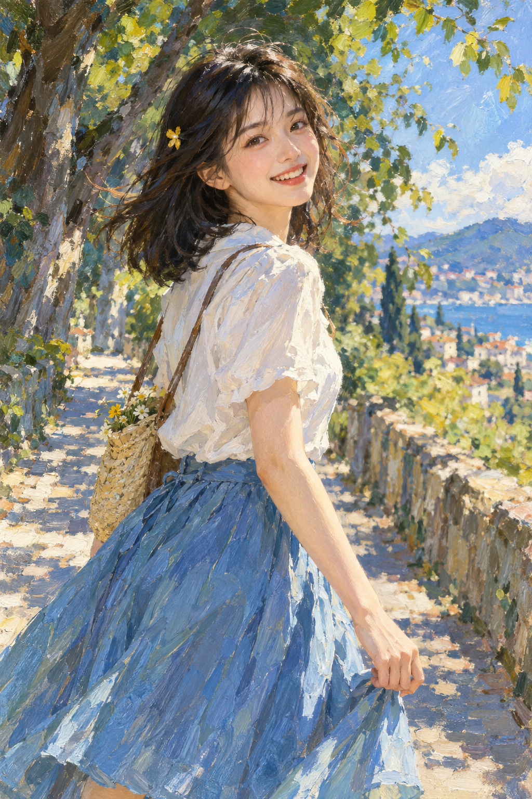

# 03 厚涂油画风：把光变成笔触

如果水彩像风吹过纸面，这张则像把夏天一笔一笔放到了画布上。

*图 03：模拟油画笔触与局部厚涂的教学插图，不是真实颜料表面。*

**类型：媒介效果与绘画方法。**厚涂是颜料较厚、笔痕较明显的一种方法，不是所有油画的统一面貌。油画也可以薄涂和细腻平滑。

## 来源与发展

油画不是凡·艾克凭空发明的。National Gallery 记录北欧十三、十四世纪已有相关使用，凡·艾克与康平进一步发挥性质，随后在十五世纪早期传入意大利绘画实践。[S38](https://www.nationalgallery.org.uk/paintings/glossary/oil)

油画可以平滑，也可以让笔触很显眼。梵高《星夜》（1889）提供另一条可旁读的路径：把笔触方向与色彩节奏放到观看前台。它是某位作者的具体实践，不是所有油画的终点。[S21](https://www.moma.org/collection/works/79802)

## 先别看脸，看袖子

袖子上的白并不单一：暖黄、浅蓝、紫灰组成不同方向的色块。它们既描述光照，也保留了笔刷走过的节奏。裙子上长条笔触顺着布料方向展开，树叶则由短促的小笔触聚合。

脸部更平滑，衣服和背景更粗放。这种细节分配把观者引向表情，同时允许外围保留绘画的动作感。若全画面都同样精细或同样粗糙，焦点就可能不那么明确。

## 冷暖如何帮助塑形

受光处偏暖，阴影处出现蓝紫。这里的冷暖关系让亮面和暗面在颜色上也分开，避免只靠“加黑”获得阴影。注意，这不是每幅画都必须遵守的公式；本图采用了这一安排。

## 别把笔触当成流派名

粗笔触不自动等于印象主义。印象主义还涉及特定的历史语境、光色观察和观看方式。本章只讨论本图的油画式外观，不能凭一张生成图把整个流派归纳为“涂得松”。

## 两分钟练习

把图缩成手机小缩略图，再放大袖口。缩小时你看到体积，放大时看到色块。试着说出某一块颜色同时做了什么：它可能既是袖子的暗面，也是沿布料方向的一笔。

**观察答案：**裙子和道路上的笔触比脸部明显；视觉信息不平均分布，而是围绕人物重点展开。

**本图兑现程度：**笔触与破碎色块明显；模拟的厚度不能当作真正的油画堆积。脸部写实处理与背景松笔构成融合。
