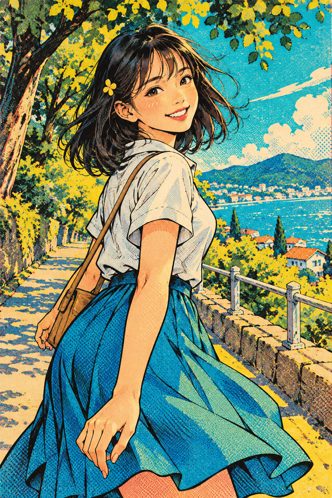

# 04 复古波普漫画风：让印刷痕迹变成主角

你仿佛刚从旧杂志里翻出一张夏日海报。颜色响亮，纸面有颗粒，笑容一下就跳到眼前。

*图 04：模拟复古漫画与波普视觉元素的教学插图。*

**类型：漫画视觉语言与波普元素的组合。**这不是以一张图概括历史波普艺术，更不是只要有网点就属于波普艺术。

## 观察脸颊和衬衫

脸颊、手臂和衬衫的暗处能看到规则小点。点的分布给平面颜色增加明暗，同时带来复制印刷的联想。粗细变化的黑线明确划开头发、袖口、手指与裙褶，阅读速度很快。

整图主要以青蓝、明黄、暖橙与黑色组织，色彩关系比自然光照更突出。大面积蓝裙和黄色树叶形成对比；深色头发给面部提供了醒目的背景。

## 网点不是随便撒的噪声

规则点阵能在某些区域承担色调或阴影作用。随机颗粒更多提供表面质感，二者可以共存。若只在完成的写实图上覆盖一层点，造型和构图可能仍没有变化。

本图的吸引力来自轮廓、限色倾向、点阵和构图一起工作。题材仍保留细腻的风景，所以它更像复古漫画插画海报。

## 与 Riso 有什么不同

Riso 章节重点是少量色版的叠印关系和局部错位；本章重点是黑线、鲜明色块和漫画网点。两者外观可能交叉，不应仅凭颗粒把它们当作同一种工艺。

## 两分钟练习

在纸上画两组小点：一组疏，一组密。把纸放远，看哪组显得更暗。再画一片随机散点，比较规则点阵与噪声的感觉。

**观察答案：**脸部和衣服上的网点最容易辨认；天空与树叶还混有其他颗粒纹理。

**本图兑现程度：**网点、黑线和高对比色彩明显；它是现代复古融合示意，不是历史印刷品或某一位艺术家的作品复刻。
