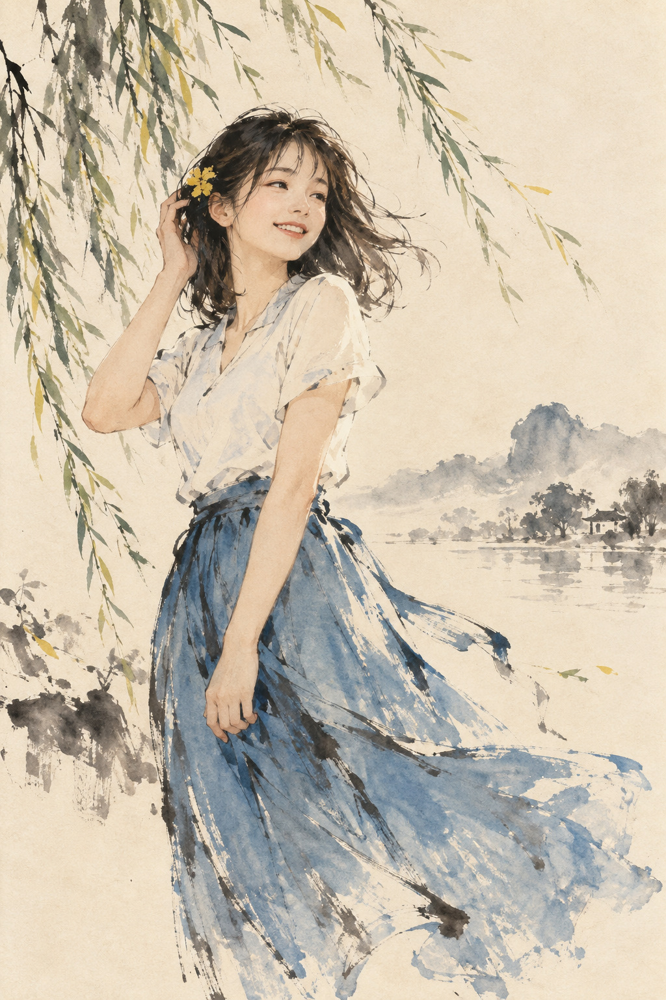

# 05 水墨淡彩：空白也能画出风

她站在柳枝下，画面右侧空着很多地方。你却不会觉得那里“什么都没有”：风和远方正从那里经过。

*图 05：现代水墨淡彩融合插画示意，人物面部较写实。*

**类型：媒介语言与中国绘画传统的融合。**本图展示部分水墨特征，不代表中国绘画只有写意与淡色。

## 看墨的浓淡，再看笔的速度

头发和柳枝有深墨般的颜色，远山很淡。相同的灰黑通过浓淡拉开距离，也分配视觉重量。裙摆上有断续、露出纸色的笔痕，类似干笔与飞白外观；宽笔触的方向帮助你感到衣服在动。

柳叶的细笔与裙摆的宽笔形成对照。如果每个地方都同样浓、同样密，空灵感就容易消失。本图用较重的左侧人物与轻淡的右侧山水维持平衡。

## 留白不是省事

留白有位置、形状和比例。人物视线朝向的空间、衣裙伸出的方向、远山周围的空隙，都使白处与已画区域互相解释。你可以把它想成音乐中的停顿：停在哪里，会改变整句的呼吸。

## 不要只找“国风素材”

柳树、山水和古纸色并不是水墨语言的充分条件。没有这些题材，笔墨与留白仍然可以成立。反过来，用写实喷绘画一座中式亭子，也不会自动成为水墨画。

## 两分钟练习

用黑笔画三片树叶，在纸的另一边再画一片。暂时不要填满背景，观察空白怎样把两组叶子联系起来。只加一条线，试试让构图更连贯。

**观察答案：**右侧山水与人物之间的空白让远景后退；裙摆的飞白让纸色参与运动感。

**本图兑现程度：**墨色层次、留白与笔势清楚；脸和手仍偏细腻写实。要把它称为现代水墨融合图，而不是纯粹传统写意人物画。
