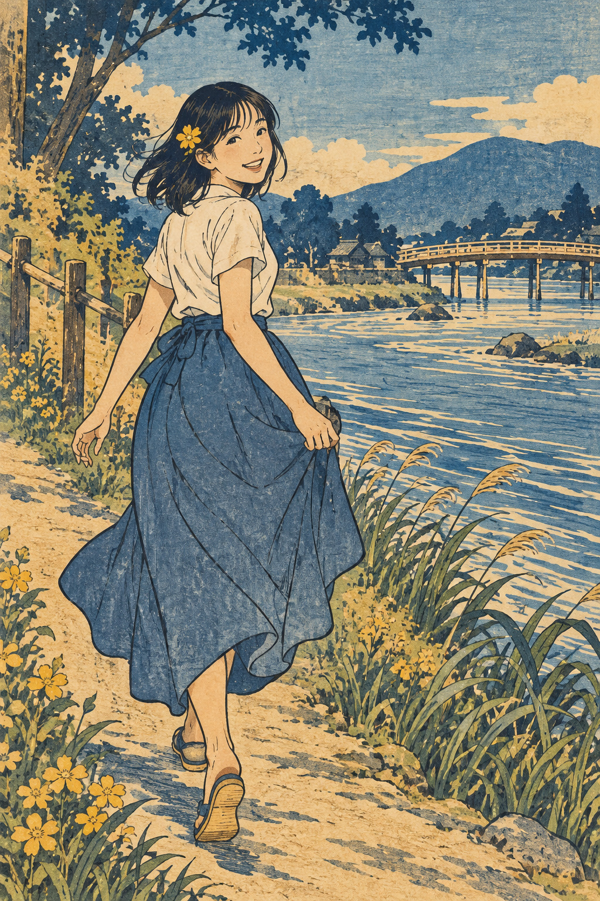

# 06 浮世绘木版画风：把河岸变成线与色的舞台

她沿河岸走着，转过身来。小路、桥、芦苇和水纹各走各的方向，却让你的视线在画面里悠闲散步。

*图 06：现代题材与浮世绘木版画视觉语言结合的生成插图。*

**类型：艺术传统与木版印刷语言。**浮世绘包含绘画与版画；本章聚焦彩色木版画外观。

## 来源与发展

浮世绘与江户时期的城市消费文化有关，题材包含演员、美人和风景等；多色木版需要设计、刻版与印刷协作。它不是只由某个浪花图案定义的风格。[S1](https://www.metmuseum.org/essays/woodblock-prints-in-the-ukiyo-e-style)

北斋《神奈川冲浪里》的馆方记录约为 1830—1832 年，材料为纸上墨与色的木版画。新增河浪图提取的是大浪、小船与远景的尺度关系，不复制原作构图。[S22](https://www.metmuseum.org/art/collection/search/45434)

## 三条路线

小路斜向延伸，桥梁横向跨过河面，芦苇倾斜进入前景。水面则用反复的波纹形成节奏。你不只是在看人物，也在跟随这些线条穿过空间。

人物的裙褶由轮廓线与内部线条交代，渐变较少。靛蓝、土黄和纸色把不同物体纳入一个统一色调。这里的平面感不是“不会画深度”，而是一种压缩和组织方式。

## 工艺会留下什么逻辑

真实的多色木版印刷可以用不同色版逐次印到同一张纸上，定位关系很重要。设计、刻版与印刷也可能由不同人员合作。这个过程帮助我们理解清楚轮廓、色块和重复纹样为什么适合这种图像。来源见 [S1](https://www.metmuseum.org/essays/woodblock-prints-in-the-ukiyo-e-style)。

本图只是模拟；古纸色和磨损纹理不能证明它经过制版。旧感也不是浮世绘的必备条件，保存良好的真实版画可以有鲜明颜色。

## 两分钟练习

只用两支彩笔画一张河岸小地图。规定每个物体只用一种平面颜色，允许用线表现水纹。你会开始用形状与节奏解决问题，而不是依赖渐变。

**观察答案：**深蓝裙子被线条分出褶皱，水面通过反复浅色带保持可读性。路径的交叉让平面画面仍有空间。

**本图兑现程度：**线与色块组织明确；人物表情更接近现代漫画，风景纹理也含数字模拟。它是浮世绘启发的现代插画。
