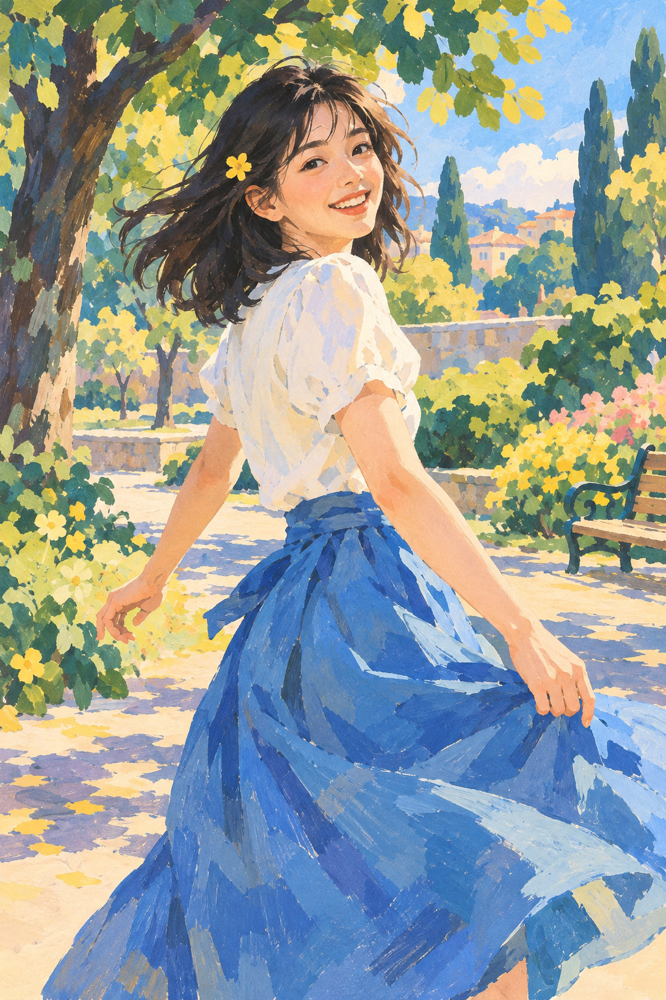

# 07 Gouache：把颜色稳稳地放在纸上

同样的夏天，这张颜色像有了自己的重量。蓝裙、黄叶和白衣不再那么透明，而像一块块有触感的色面。

*图 07：模拟 gouache 的哑光覆盖与块面笔触；成图比预设更偏写实。*

**类型：媒介效果。**Gouache 常译不透明水彩或水粉。现实材料的覆盖力、干湿变化与具体颜料有关，不能只凭生成图断定。透明与不透明水彩的关联可参见 [S8](../editorial/SOURCES.md)。

## 从树叶开始看

树叶被归纳成较实的绿色与黄色形状，边缘留有短笔触。衬衫上浅黄、蓝灰和纸白般的颜色相互叠置。裙子也能看出不同蓝色色块，没有水彩图那种大面积透明流动感。

这张的人物塑形依然细腻，所以不是极简平涂。它展示的是“不透明块面参与写实”的一条路径。Gouache 既能画平面图案，也能画有体积的人物，不需要把二者割裂。

## 哑光与厚度是两件事

哑光描述光泽，厚涂描述颜料层与笔触状态。图 07 的哑光色面比图 03 更统一，图 03 则更强调破碎笔触和局部堆积的模拟效果。两者都可能有可见笔痕，因此仅凭“有笔触”分不清。

## 两分钟练习

用两张不透明彩纸剪出树冠和树干，把浅色形状压在深色形状上。再看水彩章节的透明叠色练习，比较“覆盖”与“透出”。剪纸不能代替真实颜料，但能帮助理解图形关系。

**观察答案：**本图衣服与树叶的浅色部分更像独立色块，水彩图的浅色更像纸色与薄层共同产生。

**本图兑现程度：**覆盖感、哑光与块面明显；原计划的高度简化图形没有完全实现。它与油画章的接近之处，也是学习跨媒介相似外观的好机会。
