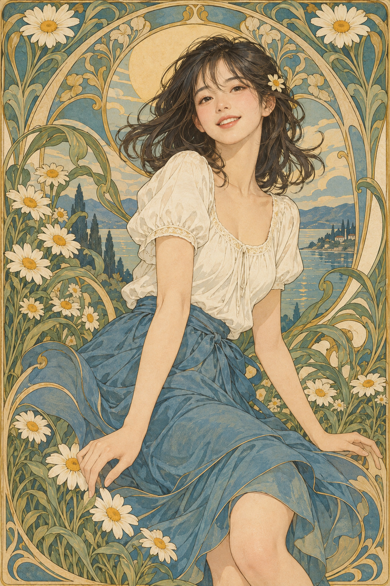

# 08 新艺术装饰插画：让头发和花一起生长

人物坐在花丛中央，头发、裙褶、叶片和边框像是在合奏一首曲线的歌。

*图 08：新艺术装饰语汇与现代写实人物融合的教学插图。*

**类型：艺术与设计流派的视觉借鉴。**新艺术不仅是一种人物海报画法，也涉及建筑、装饰与应用艺术。自然形态与蜿蜒曲线是重要观察入口。来源见 [S2](../editorial/SOURCES.md)。

## 不要先数花，先追线

沿画面边框往上看，植物茎叶不断弯折、伸长和回旋。再看头发的弧线与裙褶，它们与植物形成呼应。装饰在这里参与组织整个画面，不只是把花贴在四周。

头后的圆形与外侧拱框把人物固定在中心；花叶又打破机械对称，保持流动。蓝绿、奶油白和赭金色让许多细节仍能处于同一个色调体系中。

## 与普通花卉头像的区别

普通头像也可以带花，但花与人物可能各自独立。本图试图让人的轮廓、衣服和背景共享曲线节奏。如果去掉边框和植物，画面的装饰性会明显降低；它们是真正的结构组成部分。

与装饰艺术 Art Deco 的入门区别，可以从植物曲线与几何节奏切入，但不是绝对边界；两者都有复杂分支与交叉。进一步阅读见 [S7](../editorial/SOURCES.md)。

## 两分钟练习

画一条长长的 S 曲线，让它依次变成发丝、树枝与裙边。看看能否让三种物体保持同一种节奏。练习目的是视觉一致性，不需要画完整人物。

**观察答案：**头发、叶片与裙褶形成弧线联系，圆形与拱框负责集中视线。脸部细腻度比边框高。

**本图兑现程度：**装饰构图与植物曲线明显；人物面部较现代写实，属于融合风格，不是历史海报的严格复原。
