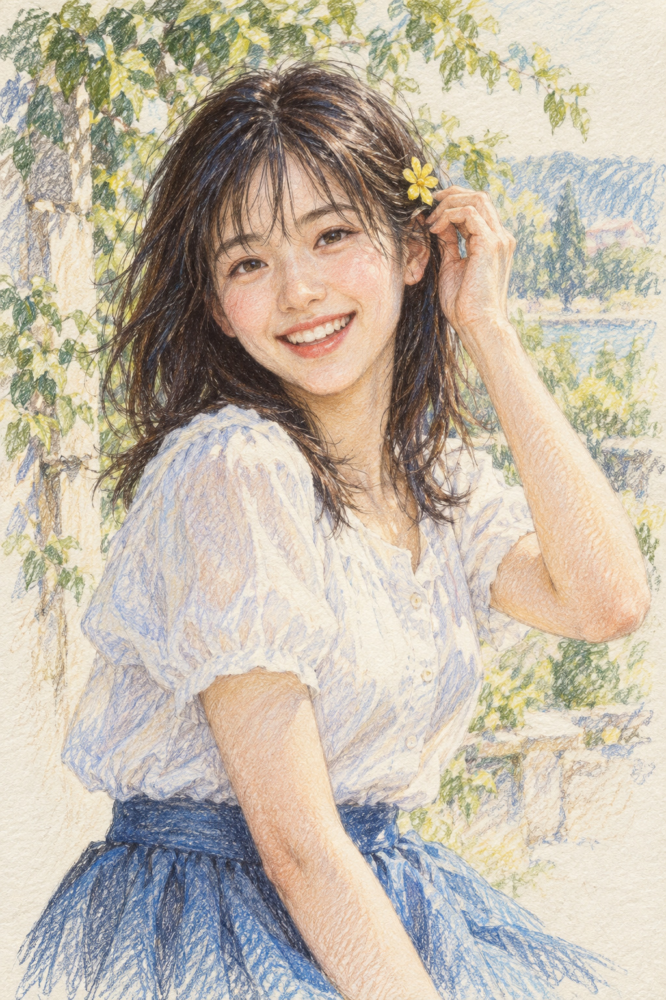

# 09 彩铅：把亲近感藏在细线里

她调整着发饰，像你坐在对面时随手记录下的一刻。画面没有强烈特效，却让人愿意靠近看。

*图 09：模拟彩铅叠色、排线与纸纹的教学插图。*

**类型：媒介效果。**本图模仿彩铅的细密线痕，实际颜色来自数字生成。

## 近看头发，远看脸

头发由许多方向明确的线聚成发束。脸上浅浅的桃色与灰蓝层次较细，纸纹始终参与表面效果。白衣用蓝紫细线交代褶皱，背景线条更松散。

排线是把一组线安排在一起；交叉排线让不同方向的线重叠。线的密度、颜色和轻重可以逐步建立暗部。你远看时读到体积，近看时又能发现它由许多小动作组成。

## 为什么像速写本

人物脸部完整，背景保留未完全铺满的地方。这种“重点完成、外围放松”的处理营造记录感。速写感不是彩铅的唯一方向，彩铅也能画得非常光滑与细致。

与炭笔比，彩铅在本图里靠细线和多种颜色积累体积；炭笔章节则更突出大块黑、擦出的亮部和中间灰。与水彩比，本图少了自然流动的水痕，方向性的线更多。

## 两分钟练习

用一支铅笔画三小块：第一块线很疏，第二块线很密，第三块再交叉一层。把纸放远，比较灰度。再顺着一片叶子的方向排线，看看方向怎样影响形体。

**观察答案：**发丝和白衣最容易找到方向性线痕；脸部使用更细的颗粒与叠色效果，外围则松。

**本图兑现程度：**细线、叠色与纸纹清楚；面部仍含较均匀的数字塑形。纸纹不是工艺鉴定证据。
