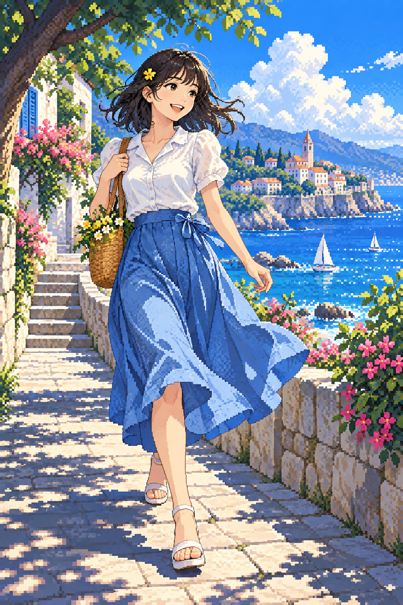

# 10 像素风：小方块也能吹来海风

这张像一款夏日冒险游戏的开场：她走下石阶，海湾正等着被探索。

*图 10：像素风教学插画；并非严格统一网格的游戏像素素材。*

**类型：数字构形方式及其外观模拟。**严格像素艺术中的像素安排是造型决策，不能简单理解为低清图片。

## 来源与发展

像素语言与电子游戏制作有重要联系，却没有一个覆盖全部实践的唯一创始人。Nintendo 的开发者访谈记录了同一游戏里像素、插画与多边形角色并存，以及多方向角色的制作难题。[S27](https://www.nintendo.com/en-za/Iwata-Asks/Iwata-Asks-Mario-Luigi-Dream-Team-Bros-/Mario-Luigi-Dream-Team-Bros-/2-Pixel-Artists/2-Pixel-Artists-778636.html)

这提醒我们，发展不是“像素落后、三维先进”的单线替代。一个项目可以为不同任务选择不同语言。本书的新集市图尝试把方块用于完整场景；它是否严格遵守网格，还需实际核对。

## 看阶梯边缘，再看成组色块

树叶、裙边和远处建筑出现阶梯形边缘，小色块聚成较大的形状。蓝裙的亮面与暗面仍清楚，说明方块没有妨碍读出体积。天空、海水和阴影用了不同层次的蓝，让空间保持秩序。

像素簇可以理解为“一群一起工作的像素”：它们共同表达发束、褶皱或树叶。如果每个像素都只是随机噪声，图像会碎；如果完全平滑，又会失去明确的像素结构。

## 这张为什么需要保留评价

脸部、天空与某些细线的尺度不完全统一，还能看到平滑过渡。因此本图更准确的名字是“像素风插画”，不能声称它严格按固定低分辨率网格制作。提示词中的目标并不能证明结果达标。

这恰好教我们一个好习惯：放大检查是否所有边缘都有相同规则。若准备做游戏素材，还需要统一逻辑分辨率、调色板和缩放方式；看起来像，并不等于工程可直接用。

## 两分钟练习

在方格纸上只用十六格宽画一片叶子。每格只选涂或不涂，不加平滑过渡。看看哪一格的改变最影响轮廓。你会体会限制如何迫使人选择。

**观察答案：**裙子与建筑较有像素簇感；脸部和天空更细腻。青春与冒险感也来自动作、海湾和高明度配色，不能全归功于像素。

**本图兑现程度：**像素外观明显，但统一网格与严格限色未得到证实。将它当作入门观察图，不当作制作规范样本。
