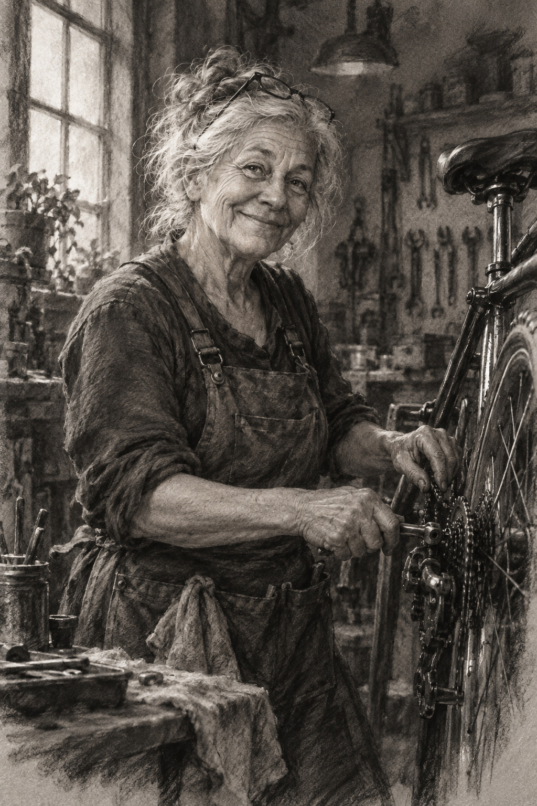

# 11 炭笔风：没有颜色，也有温度

修车师傅抬起头笑了。她的头发被窗光照亮，手还停在车轮旁。没有彩色，你仍能感到这个人的亲切。

*图 11：高度写实的炭笔风生成图，黑灰层次和粉状纹理明显。*

**类型：媒介效果。**炭笔的入门观察重点是明度：从白到黑的亮暗层次。它不只是“把彩色图转为灰色”。

## 从窗边到脸，再到围裙

左侧窗光给头发和脸提供亮部，围裙和背景工具较暗。手与车轮保留一些清楚细节，墙面则松散。亮暗分配让人物从复杂背景中浮现，也建立了工作室的空间。

炭笔外观常能容纳宽阔暗面、粉状颗粒、擦开的灰和尖锐线痕。真实作画时也可以通过擦除形成亮部。本图模拟这一效果，但不能推断某道白线真的由橡皮擦出。

## 灰度也可以丰富

头发上的浅灰、脸颊上的中灰、围裙的大暗面各有作用。木刻章更接近大块黑白对立，本图则靠许多中间层次保持皮肤和布料的柔和变化。

年龄、劳动痕迹和微笑构成了人物故事。换角色后，你会发现“有生命力”不必等于年轻、光滑或漂亮。图像的吸引力也可以来自经验与性格。

## 两分钟练习

用普通铅笔在一张纸上画五块，从纸白到深黑。用手指轻轻擦一块，再用橡皮擦出小亮点，比较线、擦痕与颗粒。普通铅笔不能完全模拟炭笔，但足够体验“加暗”和“减暗”两种动作。

**观察答案：**脸部和头发的亮部形成视觉中心，外围工具的低对比让背景退后。轮廓并非处处靠外线封住。

**本图兑现程度：**粉状纹理与灰度丰富；人物和车轮极为写实，整体接近摄影式精细描绘。作为炭笔风示意成立，但不适合作为松散手绘笔法的唯一例子。
