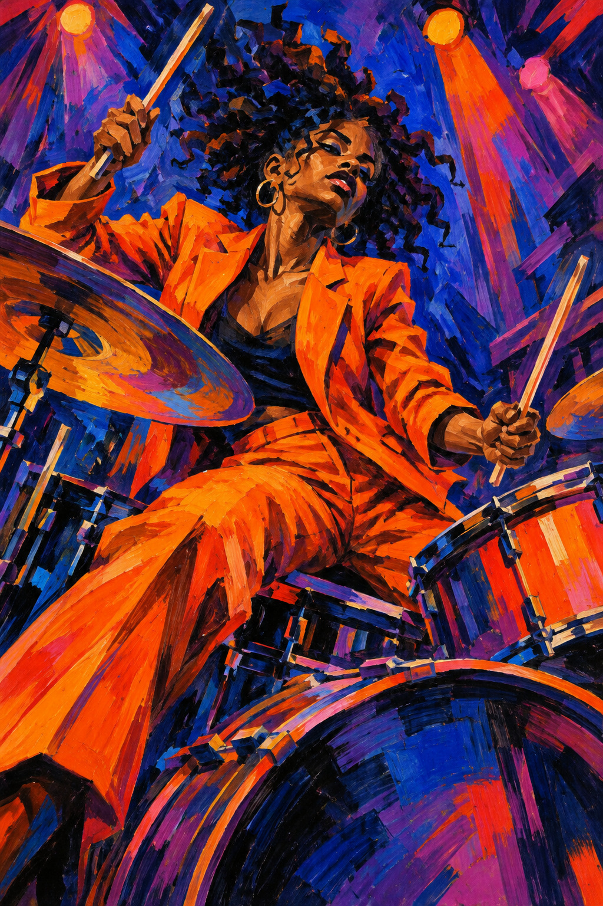

# 12 表现主义启发：如果颜色也能敲鼓

你听不到声音，却仿佛感到鼓点。橙色衣服冲向前方，蓝紫背景像在震动，笔触的方向甚至比物体轮廓更激烈。

*图 12：表现主义视觉语言启发的现代鼓手插图，仍保留较强写实结构。*

**类型：艺术流派的视觉借鉴。**表现主义可以从“让主观感受改变形与色”入门，不能简单归为乱画或用鲜艳颜色。相关资料见 [S3](https://www.moma.org/collection/terms/expressionism)。

## 来源与发展

表现主义的阅读语境包含二十世纪早期的城市、战争、人物与主观经验。MoMA 的主题页把绘画、电影和木刻放在同一组观看入口里，说明它跨越媒介。[S3](https://www.moma.org/collection/terms/expressionism)

发展中的共同问题不是“大家都用橙蓝”，而是怎样让外部世界承担内部经验。本书把鼓手节奏与形变联系，是对这张示意的编辑解读；历史作品可能呈现完全不同的强度与情绪。

## 观察颜色如何把声音画出来

橙与蓝在大面积上相互对抗。背景的斜向笔触、灯光的长条形、鼓手扬起的手臂与鼓棒共同形成节奏。头发没有被整理成均匀柔顺的发丝，而是碎裂、跳动的深色块。

面部有夸张的暗面和转折，衣服褶皱也呈尖锐折线。它们让演奏显得投入。颜色不再只是记录衣服和灯光的客观色，而在帮助强调画面的情绪。

## 强烈不等于愤怒

表现性的处理可以表现焦虑，也可以表现兴奋、压迫、喜悦或孤独。本图偏热烈。若把同样的斜线、冷暖对抗用于空旷街道，情绪可能完全不同。形与色要连同题材一起看。

不要与抽象表现主义直接混为一谈：本图有明确人物与演奏场景；抽象表现主义涉及另一段历史和多种抽象实践。本书这里只展示一个易读的表现性方向。

## 两分钟练习

画同一个方形两次。第一次用整齐浅色线，第二次用急促深色斜线。不改变方形本身，看看你会用什么词形容两张。再换一组颜色，观察情绪是否改变。

**观察答案：**节奏感由鼓棒、灯束和笔触同时建立。橙蓝对比放大活力，但“鼓手正在演奏”的题材也是关键。

**本图兑现程度：**情绪性配色、笔触与局部形变明显；人体整体仍比较写实，属于表现主义启发插画，不能代替整个历史流派。
