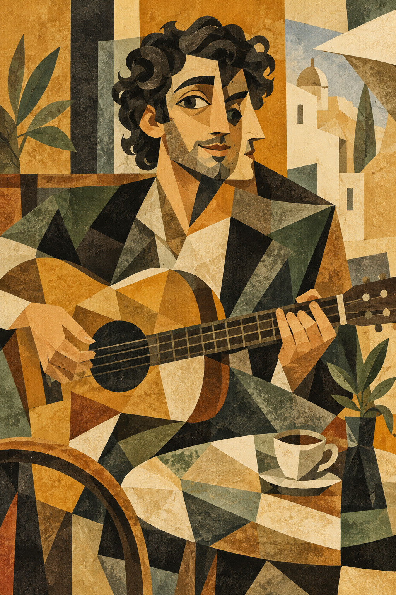

# 13 立体主义启发：一次看见几个角度

咖啡馆乐手的脸看起来有点奇怪：你似乎既看见正面，又看见侧面。他不是站在两面镜子之间，画面本身就在重组观看方式。

*图 13：立体主义启发的图形插画，正侧面并置被处理得较直观。*

**类型：艺术流派的视觉借鉴。**几何分解、多视点与空间重组是入门入口；不同立体主义作品的做法并不相同。资料见 [S4](../editorial/SOURCES.md)。

## 先看鼻子，再看桌面

脸中央有正面的眼睛和五官关系，右侧又出现侧面鼻子的轮廓。身体、衣领与背景被切成相互咬合的平面。桌上的杯碟和琴身也被纳入同一种几何节奏，人物没有孤立于背景之外。

这与给写实图加低多边形滤镜不同：滤镜可能只把原有明暗切碎，观看位置仍然不变。本图至少试图改变五官和空间关系，让不同时刻、不同方向的观察同时存在。

## 为什么还认得出吉他

琴弦、音孔、琴颈和手的动作保留了少量识别线索。你不需要每个部分都写实，也能认出对象。图像在“打散”与“让人读懂”之间选择了较亲切的位置。

色彩较克制，赭黄、灰绿、深黑和纸白把碎片统一起来。多视点不是立体主义所有作品都必须显而易见的检查项，但它是这一教学图最方便的观察入口。

## 两分钟练习

把杯子从正面和上方各画一次，再剪下两张的小部分，拼成一个杯子。让杯口保留俯视形状，杯身保留正面轮廓。你得到的是“观看的组合”，而不是坏掉的杯子。

**观察答案：**面部正侧关系最明显；桌面与杯碟也不完全服从单一视点。几何只是手段，观看方式的变化更值得注意。

**本图兑现程度：**多视点和形面重组明显；正侧面并置较字面化，装饰感也强。适合入门，不等于某个历史阶段的严格范本。
