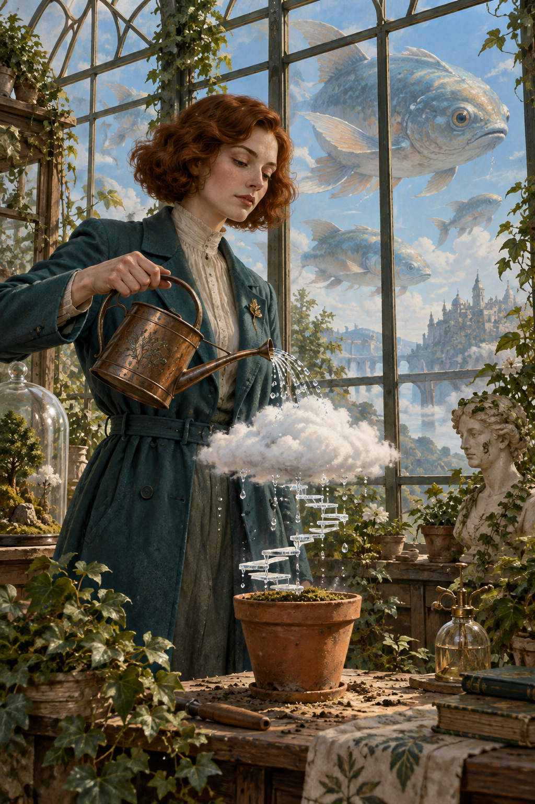

# 14 超现实主义启发：认真地做一件不可能的事

植物学家正在给一团云浇水。窗外的鱼游在天空里。她没有惊讶，正因为一切都如此平静，你才会觉得这世界不太对。

*图 14：以写实外观表达不可能关系的超现实主义启发插图。*

**类型：艺术流派的视觉借鉴。**梦、非理性联想和意外关系是方便理解的一条路径；真实超现实主义也包含自动性、拼装等多种方法。资料见 [S5](../editorial/SOURCES.md)。

## 物体很真，关系很假

铜壶、衣服、玻璃和陶盆都被刻画得有重量与材质。正是这种可信外观，让天空中的鱼与盆上的云更加突兀。若每件东西都只是随意变形，你可能只会觉得它是卡通世界。

云下面出现细小台阶般的形状，浇水从园艺动作变成了一个无法立刻解释的故事。画面保留正常光照和空间，让局部不可能之处成为阅读重点。

## 和普通幻想场景怎么分

幻想故事可以建立一致的魔法规则，让观者接受飞鱼是一种生物。本图没有给出这种规则，而是让熟悉对象的功能与位置发生错置，保持谜一样的关系。这是本图的入门区别，不是幻想与超现实主义之间绝对的分类边界。

也不要替它编出唯一象征答案。云可以让你想到天气、想法或照顾，但图像没有规定正确解释。先描述实际关系，再谈联想，会比直接套用“潜意识”更具体。

## 两分钟练习

选两个日常物体，交换它们的功能：给钟表梳头、用门收藏风、给影子倒茶。只选一个关系认真展开，保持其他环境正常。你会发现，一个清楚的不可能关系往往比十种奇怪道具更有趣。

**观察答案：**外观越可信，鱼在空中与云在盆上越显得异常；人物平静的动作增强了这一反差。

**本图兑现程度：**不可能关系很清楚；画面较接近写实数字绘画，油画笔触较弱。此章的风格重点是逻辑与联想，而非固定的表面笔法。
