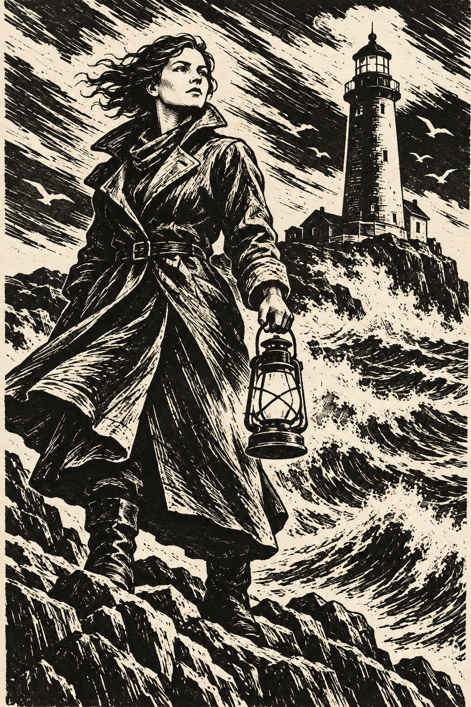

# 15 黑白木刻风：用白痕切开风浪

守灯人站在海边。衣服、天空和浪花只有黑与暖白，却像能听见风刮过画面。

*图 15：模拟黑白凸版木刻的刀痕与二值对比。*

**类型：版画工艺的视觉借鉴。**真实凸版中，保留下来的凸起表面承接油墨，刻去的部分通常不印出；这里是生成的外观模拟。木版原理可参见 [S1](../editorial/SOURCES.md)。

## 把白线当成动作

大衣主要是深色，斜向白痕把它切成褶皱和受光面。天空的白色带从左上方扫向右下，浪花又用弯曲刻痕翻起来。线条顺着物体或运动方向展开，不是统一覆盖的花纹。

黑白两大值让人物剪影特别清楚。即使缩小，你仍能读出头、翻领、提灯与站姿。细线密度让局部看起来像有灰度，但它依靠的是黑白排列的视觉混合。

## 与炭笔放一起看

炭笔图有大量柔和中间灰，木刻图则更强调清楚的黑白形状。两张都能画强烈光线，但选择不同：一个通过灰层塑形，一个通过黑白面积和刻痕塑形。

黑白不自动等于木刻。钢笔、漫画和剪纸也能黑白。需要一起看刀痕般的方向、凸版的形状逻辑与墨块组织。

## 两分钟练习

在黑纸上用白笔画一件外套，不先画黑色轮廓，只画受光褶皱。或者在纸上涂黑一小块，用白色修正带模拟几道亮痕。此练习不需要真实刻刀。

**观察答案：**天空与大衣的白痕走向不同，各自描述风与布料。人物剪影在复杂浪花前仍然清楚。

**本图兑现程度：**刀痕方向、黑白块面与印墨不均匀感明显；细线很多，部分形体仍偏写实。这是木刻风示意，不是实际制版作品。
