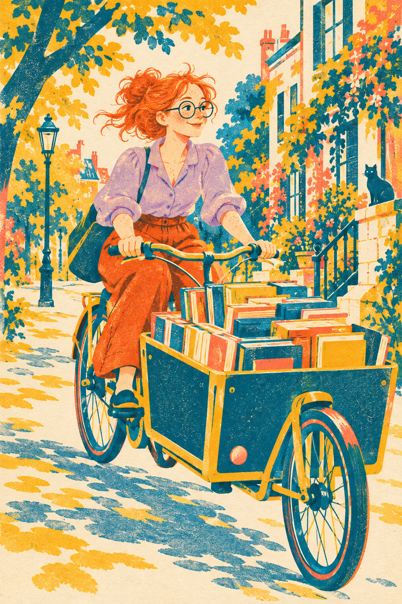

# 16 Riso 孔版印刷风：颜色错开一点，也很可爱

书店店主把一车书送往街角。车和树叶由亮色拼成，边缘偶尔有一点错开，像刚印出来的小刊物。

*图 16：Riso 风教学示意，表现了限色倾向与颗粒；没有严格兑现三色分版。*

**类型：印刷工艺启发的视觉语言。**RISOGRAPH 是结合传统孔版原理与数字技术的印刷设备体系；“Riso 风”在这里指对其某些印刷外观的借鉴。来源见 [S6](../editorial/SOURCES.md)。

## 先把颜色分成几组

青蓝负责树干、车体、眼镜和不少阴影；黄负责光照与部分书本；珊瑚红负责头发、衣服和建筑点缀。重复使用相近颜色把复杂街景压成可读图形。

你还能看到颗粒与局部边缘错开。真实多色印刷的套准，是让不同色版落到预定位置；少量错位可能产生双边或重叠效果。它可以成为有意保留的视觉特色，但错位不是所有真实作品都必然存在。

## 限色是一种选择

把颜色数量限制下来，会迫使创作者重新安排明暗、前后与材质。同一种青蓝可以同时表示阴影、树木与自行车，因此颜色不只是物体的固有属性，也是组织工具。

本图衣服上还出现了较独立的紫色。仅凭最终图不能证明它来自设定的三种油墨叠印，所以不能说它严格遵守三色制版。它兑现了印刷风，而没有提供可直接印刷的分色文件。

## 两分钟练习

只选三支彩笔画街角，每种颜色至少用在三个不同物体上。再把其中一个形状的轮廓平移一点，看看错位怎样改变画面。留意整体可读性是否仍然清楚。

**观察答案：**青蓝在车、树和建筑里反复出现，颗粒强化纸面联想；本图细节较丰富，并非极简图形。

**本图兑现程度：**限色倾向、颗粒与局部错位清楚；严格分版、叠印颜色与真实荧光效果无法由屏幕图证明。与复古漫画的区别要从色版关系和轮廓方法一起看。
