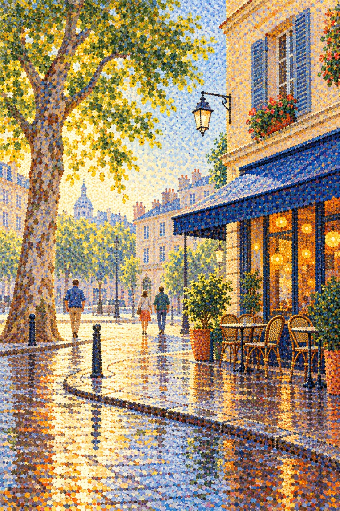

# 20 点彩：远看一条街，近看一群颜色

走近这张街角，你会发现画面在变：远处是一棵树、一排窗与一片地面，近处则变成许多分开的颜色点。

*图 20：模拟小色点并置与远近观看差异的教学图。*

**类型：绘画技法与新印象主义相关的视觉借鉴。**点彩关注小色点构形；分色指把不同颜色的小笔触分开安排；它与新印象主义涉及更广泛的色彩组织，不能把所有点状画法都归入同一流派。资料见 [S12](https://www.metmuseum.org/essays/georges-seurat-1859-1891-and-neo-impressionism)。

## 来源与发展

十九世纪八十年代，修拉与相关新印象主义实践把色彩理论、小笔触分离和较有计划的制作联系起来。点彩特指点状施色，分色与运动的范围更宽。[S12](https://www.metmuseum.org/essays/georges-seurat-1859-1891-and-neo-impressionism)

这并非在印象主义图上添加颗粒的下一步。新增公园图让人物和湖岸也交给色点构形；发展中改变的是图像的组织方法，而不是只改变表面装饰。

## 让眼睛做一点工作

冷暖小色点彼此邻近，远看时倾向共同形成较大的区域。亮墙、树冠与湿地并不是先涂一个均匀大色块再撒点，而试图由小点的颜色、密度和排列建立整体。

这个观看效应受到点的尺寸、距离、显示大小和颜色对比影响，不能保证所有点都自动混成某个理论色。入门时先比较远近两个尺度，就足够发现方法的不同。

## 点不是一种通用纹理

漫画网点常在已经明确的轮廓中帮助产生色调；点彩图更尝试让点本身构成整个形与色。像素艺术则涉及离散网格与像素簇安排，不要求模仿笔刷的圆点。三种方法可能相似，但问题不同。

## 容易认错什么

随机噪声不等于点彩。要看不同区域的点是否共同解释形体和颜色。数字生成图也可能把小点与其他笔触混合，标签不能代替放大检查。

## 三分钟练习

用两支不同颜色的笔分别画点，尽量不把颜色在纸上涂混。把纸先放近、再放远，观察你看到的是两个点群还是一个色区。换一种密度再试一次。

**参考答案：**远看更容易读到整体色调，近看更容易区分点；效果取决于尺寸与排列，并不总是完整融合。

**本图兑现程度：**墙面、树冠与地面大部分由小圆点和短小菱形色痕构成，点状构形明显；路灯等细长暗部仍较连续，局部也混入短笔触。它模拟点彩外观，不是科学配色实验或真实颜料样本。
