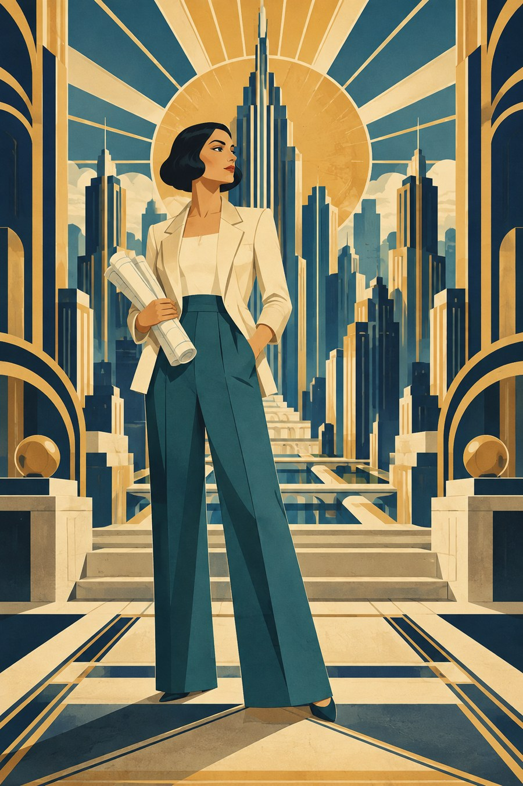

# 22 装饰艺术：给城市安排一种几何节奏

建筑师站在阶梯与高楼之间。身后的太阳像一把打开的扇子，城市轮廓整齐地升高，画面显得有秩序又有舞台感。

*图 22：Art Deco 启发的几何装饰插图。*

**类型：艺术与设计风格借鉴。**几何、流线与现代设计联想是本图的入口；装饰艺术的历史面貌比一套金蓝配色更广。资料见 [S7](../editorial/SOURCES.md)。

## 沿着高楼往上看

楼体重复竖向线和阶梯轮廓，头后的圆与放射线把人物放进中心结构。边框有弧线，但这些弧线被安排得较规则，与台阶、柱体和地面线共同工作。

人物宽腿裤、外套和手中的卷图，也被组织成简洁面块。背景与人物因此处于同一个设计系统里。青蓝、奶油色和赭金色让复杂建筑仍维持清晰对比。

## 与新艺术比较

新艺术图 08 的植物曲线会卷绕、伸展，像在生长；本图更多让重复几何与阶梯产生节奏。不过边界不是绝对的，新艺术也有几何方向，装饰艺术也能包含自然纹样。

区别应落在具体图上：这张的秩序来自哪些重复？那张的流动来自哪些曲线？不要只用“有花”和“有金色”作判断。

## 三分钟练习

把一棵树画成五个递增长方形，再把太阳画成圆与八条放射线。用相同的间距安排它们，看看自然物怎样变成一种几何装饰。

**参考答案：**重复、轴线、间距和比例能够统一许多不同物体。几何化并不只靠画三角形。

**本图兑现程度：**阶梯、竖向重复与放射构图明显；纸面颗粒是额外的复古模拟，金色外观不能证明真实金属墨或工艺。
