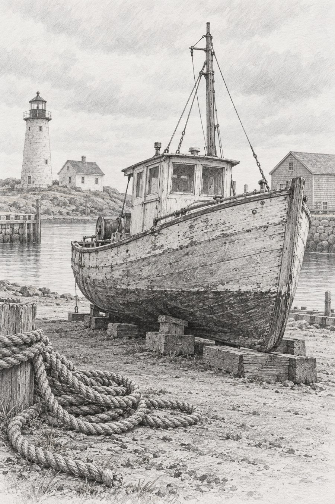

# 23 石墨素描：让一条船慢慢浮出来

港口还没开工，一条木船架在木块上。没有蓝色海水，也没有橙色灯光，你仍能感到木板的厚度和天色的轻重。

*AI 生成教学示意；真实材料与工艺以作品记录为准。*

## 这个名字放在哪个抽屉

媒介方向。石墨可以留下不同深浅的线和灰面；本章选择偏细致的观察性素描，不代表所有铅笔画都这样。真实石墨的工具与材料说明见 [S14](../editorial/SOURCES.md)。

## 先看见三个具体线索

先看船身下方：一层层灰调把船从背景里托出来。木板接缝有细线，船底阴影却靠成片的深灰。再看远处，灯塔和帆船较浅，空间不是全靠透视线，而是还靠清晰度与明暗差。天空接近纸白，留给主体更多重量。

## 效果怎样形成

线可以描述结构，侧锋或反复排线可以铺调子，擦除可以恢复亮部。同一支铅笔并不只负责轮廓。读这张图时，把“边界在哪里”与“表面有多暗”分开，便会发现两套信息合作。

## 最容易认错的地方

和炭笔相比，这张图的细节更收敛、船板纹理更细，但这只是两张示例的差别。炭笔也能画得精细，石墨也能画得很松。和钢笔相比，它允许更多连续灰调，不必把所有中间色转换成线的密度。

## 一个不用会画画的小实验

在纸上画三个相同小方块：第一个只勾边，第二个用稀排线，第三个用密排线。哪个看起来最重？为什么？

**参考答案：**通常第三个最重，因为深色面积增加。轮廓大小没变，视觉重量却改变了。若把第三个边缘擦淡，重量感还会下降；“暗”与“硬”可以分别调节。

## 诚实看待这张图

这张示意带有很细腻的灰面，部分局部接近照片式写实。它适合讲线与调子的分工，不能从屏幕证明真实石墨的反光或铅笔硬度。
