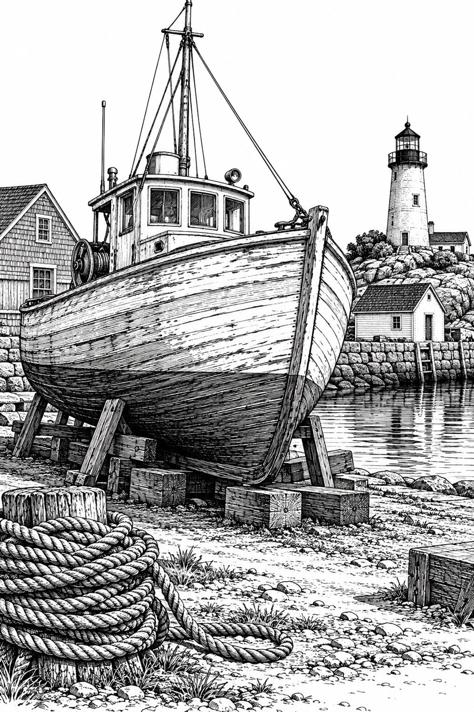

# 24 钢笔与墨线：用方向编织灰色

同一条船来到线条的世界。你靠近看，阴影里不是灰颜料，而是一束束交错的黑线；退后看，它们又合成安静的港口。

*AI 生成教学示意；真实材料与工艺以作品记录为准。*

## 这个名字放在哪个抽屉

媒介与画法方向。这里选钢笔式墨线、排线与交叉排线。墨水也可以用毛笔、洗染和其他方式处理，不能把墨画全部等同于细线。见 [S15](../editorial/SOURCES.md)。

## 先看见三个具体线索

船腹的线沿弧面转弯，木板上的线顺着长度排列。方向先告诉我们表面怎么转，密度再告诉我们哪里更暗。天空几乎空着，主体因此特别清楚。灯塔在右侧，与石墨图位置不同；比较时不要把构图变化算成工具的必然结果。

## 效果怎样形成

想象把一块中灰拆成许多黑线与白缝。线越密、越交叉，远看越暗；线越疏，纸白越多。线条还可以带节奏：整齐并行显得稳定，略微抖动会带手的气息。这种秩序比“黑白滤镜”更重要。

## 最容易认错的地方

它和石墨素描都能造出体积，区别在本例中是灰调的组织方式。它与蚀刻也可能非常像：两者都能用细线，不能只凭交叉排线判断制作工艺。

## 一个不用会画画的小实验

给一只杯子的左半边画竖线，右半边画弧线。再把两边密度调成相同。哪边更像圆杯？

**参考答案：**弧线一边通常更提示转面，因为方向跟随表面。两边即使一样暗，形体解释仍不同。密度回答“多暗”，方向回答“怎么弯”。

## 诚实看待这张图

图中船体排线清楚，天空留白很有效；部分黑块仍有连续调子感。它是墨线视觉示意，不是已确认使用某一种钢笔尖的作品。
