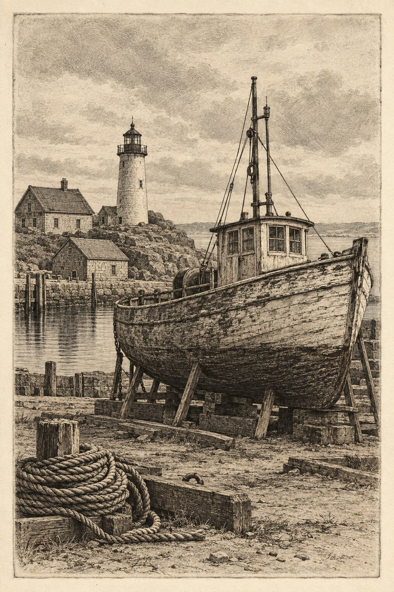

# 25 蚀刻版画风：把细线留在金属的凹处

船又停在纸上，这次四周多了一道矩形边界。天空也铺满细密线痕，仿佛港口被一张旧地图的安静包住。

*AI 生成教学示意；真实材料与工艺以作品记录为准。*

## 这个名字放在哪个抽屉

真实工艺属于凹版印刷：蚀刻利用酸液在金属版上形成可容纳油墨的凹线，再经印刷转移到纸上。见 [S16](../editorial/SOURCES.md)。本书图像模拟结果，不提供实际制版教程。

## 先看见三个具体线索

观察天空和船腹的连续细线，以及纸的暖色。矩形边界在本图中提示印版范围，主体外侧仍有空白。船体的暗部密而不平，白缝持续穿过它，使黑色拥有细碎的振动。

## 效果怎样形成

与木刻的简化记忆法一起看：木刻常让人注意留在版面上的凸起和被刻掉的白，蚀刻常让人注意凹线里的墨。但实际版画各有变体；不是“粗线必为木刻、细线必为蚀刻”。工艺说明、版痕与作品记录要一起读。

## 最容易认错的地方

最易混淆的是钢笔排线。蚀刻图可以像笔画，笔画也可以模拟版画。纸上的框线还可能只是画出来的。视觉证据能提出猜测，不能完成材料鉴定。

## 一个不用会画画的小实验

把这张图的外框用手遮住，只看船。你是否仍能确认它是蚀刻？写一个谨慎的句子。

**参考答案：**“这张图有细线排调与版画感，但仅凭船体不能确认蚀刻工艺。”这比肯定句更准确。此题练习的是判断力度，不是找隐藏答案。

## 诚实看待这张图

示意图有细密线痕、暖纸和明显边框，但生成的边框不是真实压印凹痕。远处背景也偏写实。可以用它学习外观，不能用它证明酸蚀与印刷确实发生过。
