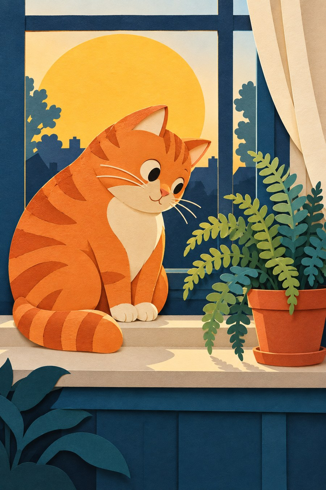

# 26 剪纸拼贴：让边缘像剪刀走过

橙猫坐在窗台上，身体像几块纸搭起来，蕨叶像一串小剪口。故事不是靠细细画出每根毛，而是靠谁盖住谁。

*AI 生成教学示意；真实材料与工艺以作品记录为准。*

## 这个名字放在哪个抽屉

材料与组织方法。本章选择多层彩纸剪贴的视觉方向，与传统单色剪纸有联系但不等同；“剪纸”并非只有一种地域传统或造型规则。

## 先看见三个具体线索

先找身体与尾巴的接缝，再看窗框和盆栽互相遮挡的地方。大色块有明确边界，细小投影让纸层显得有厚度。猫的表情仍靠少数小块解决。背景的窗帘与城市让画面多了场景感。

## 效果怎样形成

形状要先能独立站住，再依靠叠放建立关系。真实纸贴中，剪口、纸厚和粘贴会影响效果；数字或生成图则可模拟这些线索。对读者来说，关键问题是：删去内部纹理后，轮廓和重叠还讲得清吗？

## 最容易认错的地方

与拼贴相比，这个示例颜色和材料更统一；与剪影相比，内部有条纹、眼睛和分层。剪纸也可以非常繁复，所以不要把“简单”当作定义。

## 一个不用会画画的小实验

用三张不同颜色纸撕或剪出猫的头、身体和尾巴，不画眼睛。先让它能被认出，再加一只耳朵。

**参考答案：**耳朵和尾巴能提供高效的识别线索。若尾巴被身体盖住，猫可能变成一只圆团动物。重叠顺序会改变阅读，不只是装饰。

## 诚实看待这张图

这张图的纸层阴影和色块有效，但颜色数量比极简剪贴更多，也有丰富背景细节。它适合示范分层，不宜当作严格限色或某种传统剪纸的代表。
