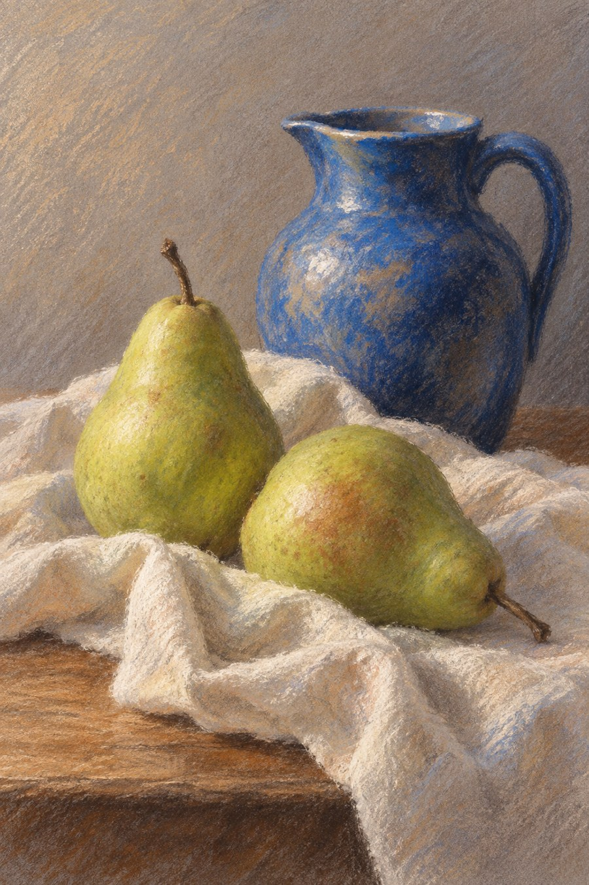

# 29 色粉画：让颜色带着纸的呼吸

两只梨与蓝壶看起来很安静，表面却有无数小颗粒。你仿佛能看到颜色轻轻停在纸齿上，而不是把整张纸封住。

*AI 生成教学示意；真实材料与工艺以作品记录为准。*

## 来源与发展

The Met 的色粉专题将欧洲的使用追溯至十六世纪，并指出它在十八世纪及十九世纪后期的兴盛。它既能留下线痕，也能宽铺和擦揉，逐渐形成独立完成图像的多种实践。[S17](https://www.metmuseum.org/perspectives/materials-and-techniques-drawing-pastel)

本章不把一种粉松静物说成色粉发展的唯一结果。它与彩铅、绘画的联系可以从线和块的分工理解；真实作品的材料说明，仍比屏幕上的颗粒更有鉴别价值。

## 这个名字放在哪个抽屉

媒介方向。色粉通常以粉状颜料、填料和少量黏结材料组成棒状工具，纸面纹理能帮助附着。见 [S17](https://www.metmuseum.org/perspectives/materials-and-techniques-drawing-pastel)。此处讲干性色粉外观，与油性粉彩需要区分。

## 先看见三个具体线索

梨的亮部不是完全光滑，斜向短痕和底色仍露出来。蓝壶的明暗靠一层层色痕交织，布面也有颗粒。轮廓有的清楚，有的松开，物体因而像处在空气里，而非被均匀描边。

## 效果怎样形成

色粉可以侧面铺宽块，也可以尖端画线，轻擦会让粉混合。留住部分颗粒，颜色会显得活跃；全部抹匀，细微线索可能消失。不是“越糊越像色粉”，而是保留与融合之间的选择。

## 最容易认错的地方

与彩铅都能露纸纹，但本例色粉块面更宽、覆盖更厚。与水彩相比，这种亮部未必依赖纯纸白，也可以来自较浅色粉。仅凭柔软感仍不能确认材料。

## 一个不用会画画的小实验

给一个圆形左边画短斜线，右边轻轻抹匀。哪个更像有表面？哪个更像柔和灯光？

**参考答案：**线痕的一边常有触感，抹匀的一边常有柔和过渡。两边都能用于色粉作品，重点是你想保留怎样的表面信息。

## 诚实看待这张图

示意图的粉粒、短痕与软硬边关系很清楚。它不能呈现真实粉层易受触碰的状态，也不能由屏幕判断是否喷了固定剂。
