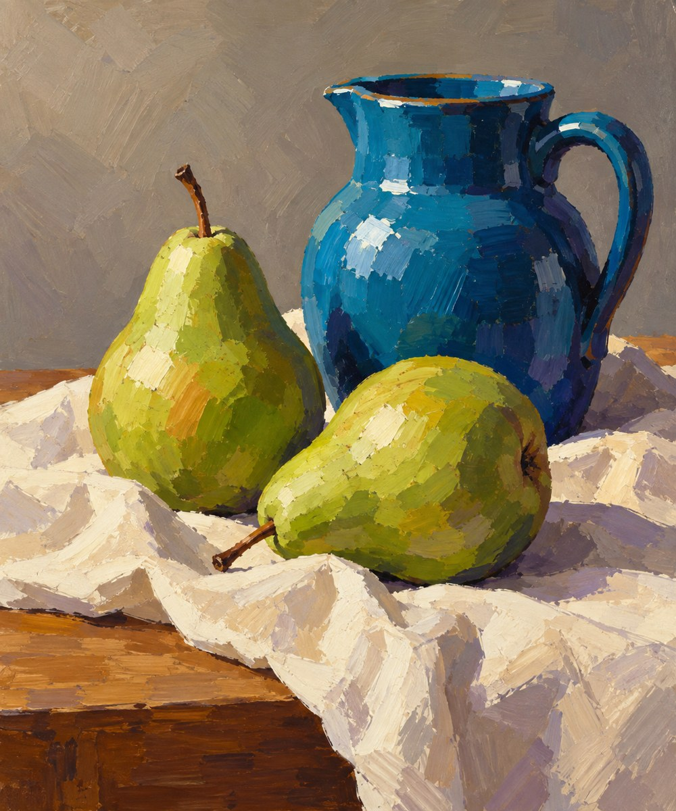

# 30 丙烯厚块面：快速建立颜色的骨架

蓝壶像由几块稳稳落下的颜色组成，梨也有硬朗的亮暗面。它不像上一张那么粉松，而像把桌上的秩序直接摆出来。

*AI 生成教学示意；真实材料与工艺以作品记录为准。*

## 来源与发展

Liquitex 的品牌历史把 1955 年水性丙烯底料与 1956 年画家颜料列为具体节点，并记录后来厚稠配方的发展。此处按品牌自述使用，不泛化为全部丙烯画法的唯一起源。[S36](https://www.liquitex.com/pages/our-story-since-1955)

今天不同稠度产品仍提供不同用法，厚块面只是其中一条。本书与油画风比较的是可见笔触，不试图用边缘硬度鉴定树脂或油性黏结材料。[S19](https://daler-rowney.com/product/system3-original-acrylic-paint/)

## 这个名字放在哪个抽屉

媒介方向。丙烯画材通常以丙烯树脂体系黏结颜料，产品可以有流体、厚重等不同形态。[S19](https://daler-rowney.com/product/system3-original-acrylic-paint/) 的官方产品资料用于说明这种多样性。本例选不透明宽笔触，绝不代表丙烯只能这样画。

## 先看见三个具体线索

壶的肩部、把手和腹部有明显色面，明暗交界较硬。白布上留有横向和斜向笔痕，背景也不是完全平涂。两只梨的颜色有颗粒与转面，而不是仅贴一块绿色。

## 效果怎样形成

宽笔先组织大关系，覆盖与叠放再修正形体。对读者来说，先看蓝壶是否在灰背景前站稳，再看小反光。若整体亮暗没分清，细节再多也容易散。具体干燥速度与透明度随画材和方法变化，不能由此图推出。

## 最容易认错的地方

和厚涂油画风常相似，两者都可能宽笔、覆盖、留纹。区别材料需要记录或检测；“看到厚笔触所以是油画”以及“硬边所以是丙烯”都过于武断。

## 一个不用会画画的小实验

把静物缩成手机上的小缩略图。你还看得到哪几个主要块面？写出三块，不要数细节。

**参考答案：**蓝壶、绿梨、浅布常最先留下来。缩小后能站稳，说明大关系较清楚。若只剩杂乱颗粒，可以重新安排明暗或颜色面积。

## 诚实看待这张图

成图具有覆盖色块和宽笔触，但也明显接近油画外观。它能讲块面组织，不能证明真实丙烯的黏结材料或干燥性质。
