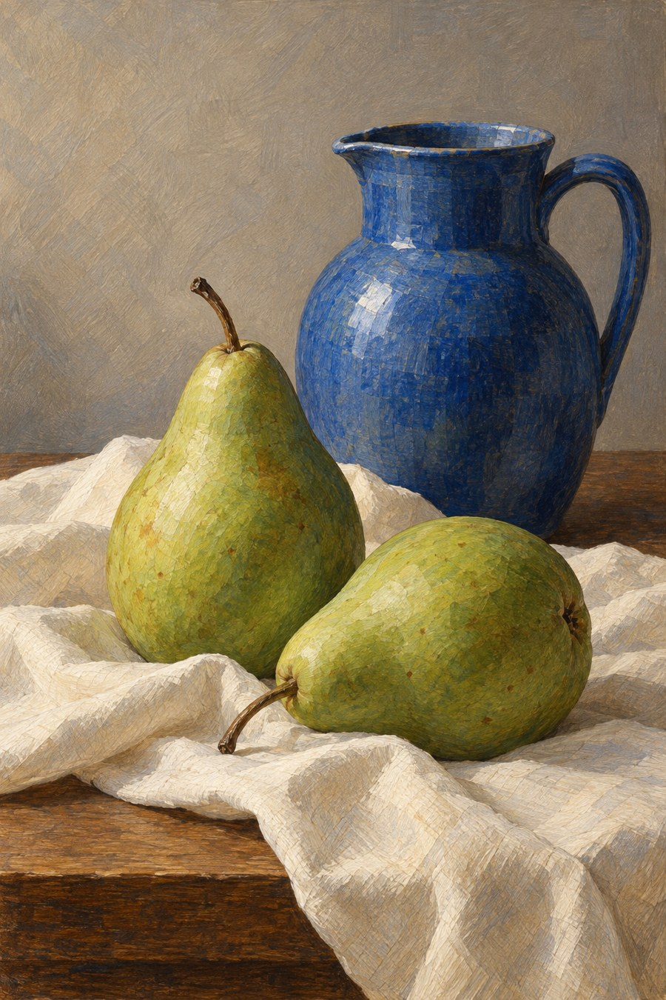

# 31 蛋彩启发：用细痕慢慢建立光

还是两只梨和一只蓝壶。画面这次收起宽大的挥动，许多小线交错着走，光像被耐心地编织出来。

*AI 生成教学示意；真实材料与工艺以作品记录为准。*

## 这个名字放在哪个抽屉

媒介方向与画法示例。Tempera 是较宽的术语，蛋彩是其中重要形式，常以蛋黄作黏结材料；见 [S18](../editorial/SOURCES.md)。这里选择细笔触叠建的方向，不能把交叉排线当作所有蛋彩的定义。

## 先看见三个具体线索

看梨的圆面和壶的颈部，浅深色由细碎线痕过渡。物体仍保持清楚边界，背景却有明显刷痕。整体光泽较含蓄，重点在缓慢累计的表面节奏。

## 效果怎样形成

你可以把它想成许多小调整，而不是一次大面积揉开。每层细痕既改变颜色也记录方向。真实蛋彩涉及底材、配制与具体技法，这里只帮助辨认一种细密构形的外观，不鼓励凭示意图自配历史材料。

## 最容易认错的地方

和色粉、彩铅都可能共享细线与纸面感。辨别外观时问“颜色怎样搭起来”；辨别材料时读说明。某种线痕并不拥有唯一媒介归属。

## 一个不用会画画的小实验

把梨的亮面想成一片地形。画五条沿转面走的短线，再画五条随机方向短线。哪一组更帮助你感到圆？

**参考答案：**沿转面走的线通常更有体积提示。随机线会突出表面纹理，甚至削弱圆感。细笔触有方向任务，不只是“加细节”。

## 诚实看待这张图

本图细线叠色明显，但背景比精工蛋彩设想更粗，局部还有素描般的质感。它是蛋彩启发的视觉示意，而非真实历史工艺的标准样本。
