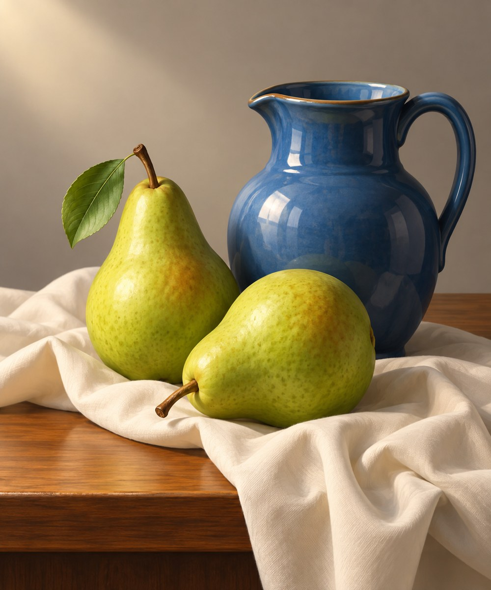

# 32 喷笔式渐变：把笔触藏进空气

壶腹变得光滑，梨的圆面从亮慢慢滑向暗。你不再先看到一笔一笔，而先看到灯光在物体上缓缓转弯。

*AI 生成教学示意；真实材料与工艺以作品记录为准。*

## 这个名字放在哪个抽屉

工具与视觉方向。真实喷笔把颜料雾化喷出，可以配合遮挡得到软边或硬边。这里模拟平滑渐变；数字绘画也能得到类似结果，图像不能证明使用了喷笔。

## 先看见三个具体线索

壶身高光呈连续变化，背景从一处颜色过渡到另一处。梨仍有小斑点，蓝壶也并非毫无纹理。注意接触阴影较硬，转面较软：两种边缘同时存在，物体才不会像一团雾。

## 效果怎样形成

平滑不等于没有结构。明暗范围、渐变位置和高光形状承担了体积说明。全部边缘都模糊，会让物体失去支撑；全部边缘都锐利，又会削弱雾化感。喷笔式画面往往靠这类分工建立清洁的光。

## 最容易认错的地方

与照片、三维渲染、数字软笔刷很容易混淆。材料判断要谨慎。它和厚块面绘画最大的可见差别，是笔痕被弱化、连续过渡被加强，而非现实感突然出现。

## 一个不用会画画的小实验

眯眼看壶，把高光、主体中调和暗面分别指出。再看哪一条边缘最硬。

**参考答案：**接触面和遮挡处常较硬，圆面转折常较软。若你只说“很柔”，就漏掉了支撑物体的硬边。

## 诚实看待这张图

成图的平滑体积成立，但果皮斑点、壶面纹理仍在，一只梨还多出绿叶。后者是题材变化，不能归因于喷笔画法；本图也并非纯粹无纹理的商业喷绘。
