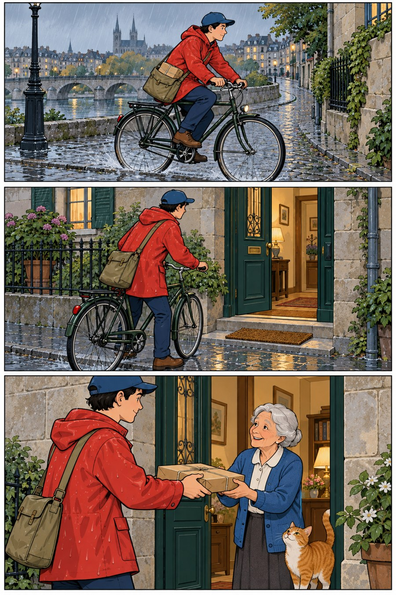

# 33 清线漫画方向：让故事读起来不费力

一个穿红雨衣的送书人沿河骑车，来到绿门前，把干燥的包裹交给老人。雨很细，故事的动作却依然清楚。

*AI 生成教学示意；真实材料与工艺以作品记录为准。*

## 这个名字放在哪个抽屉

漫画视觉方向。本章借“清线”讨论较稳定的轮廓、清楚的对象与易读分格。本书不把欧洲漫画都归入此类，也不把某一地区视作只有一种画法。

## 先看见三个具体线索

先按上中下看三件事：骑行、抵达、交接。人物轮廓相对稳定，红衣在灰蓝环境中帮助追踪角色。第三格的包裹位于两人之间，手的方向说明交换正在发生，猫提供轻松的收尾。

## 效果怎样形成

清晰来自信息分级：主要动作完整，环境帮助定位，颜色重复帮助认人。理想的简化不只是减少笔画，而是把每笔放到有用的位置。若背景与人物同样密集，阅读可能变慢；可以减弱背景对比或减少内纹。

## 最容易认错的地方

“线细”不一定就是清线。均匀线条配大量渐变、摄影式材质，可能已经是混合语言。漫画的可读性也不是某个流派独有，任何画法都需要让动作关系成立。

## 一个不用会画画的小实验

遮住第二格，故事还顺吗？再遮住第三格，故事失去什么？

**参考答案：**省掉抵达，骑行到交接仍可能连贯，但地点过渡更突然。省掉交接，送书目的没有兑现。分格负责不同信息，并非每格都同等不可删。

## 诚实看待这张图

成图轮廓和顺序易读，但雨衣、石墙与河面有大量材质、光影，明显偏离严格平涂与少阴影的清线设想。把它当作清线方向与写实场景混合的实例更准确。
