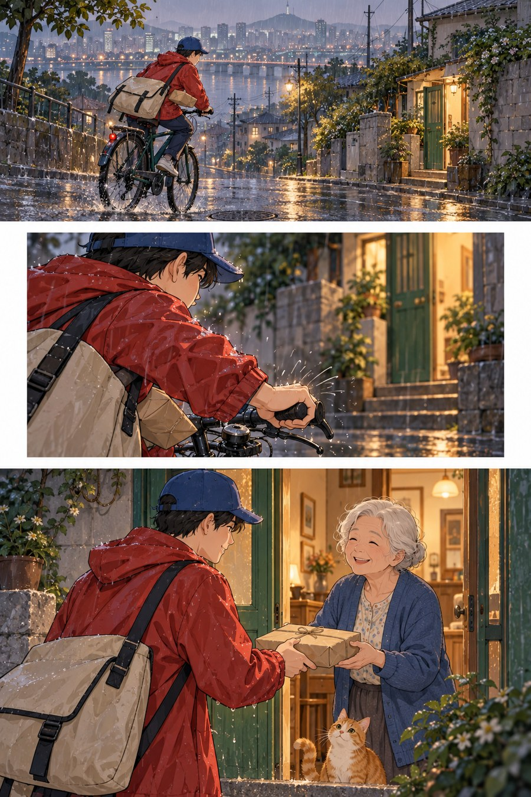

# 35 纵向网络漫画：让空隙成为时间

你向下读：雨中远景，近处握紧车把的手，门内温暖的笑脸。中间的白隙像一个轻轻的呼吸，给抵达留出时间。

*AI 生成教学示意；真实材料与工艺以作品记录为准。*

## 来源与发展

WEBTOON 官方创作者手册将平台发展与移动设备的纵向阅读联系起来，并说明分格、间距与阅读节奏；资料同时呈现多种题材和创作者。[S20](https://webtoons-static.pstatic.net/creator101/fr/pdf/Creator-Handbook.pdf?dt=2024011501)

这里的发展重点是观看格式，而非所有作品都变成柔光人物。故事、视觉画法与滚动布局可以分别调整。新增公交站示意把三个事件与不同格高联系，帮助把格式问题从风格标签中拆出来。

## 这个名字放在哪个抽屉

阅读格式与视觉方向。纵向网络漫画并非单一画风；本例选择彩色、细线、柔和光影的方向。WEBTOON 官方创作者资料 [S20](https://webtoons-static.pstatic.net/creator101/fr/pdf/Creator-Handbook.pdf?dt=2024011501) 用于说明纵向内容的布局与间距，不能代表所有平台作品。

## 先看见三个具体线索

第一段先交代河岸与小路，第二段靠近手部，第三段完成交接。第二段四周白边更宽，形成停顿。暖灯从远景的目标变成近景的情绪，读者的视线向下移动，同时完成距离的缩短。

## 效果怎样形成

滚动阅读让作者能安排何时看见下一件事。空白可以延迟揭示，也可以让一次动作显得短促；它不是越长越好。风格、分格和发布格式是三件相互关联但不能混为一谈的事。

## 最容易认错的地方

三格竖着排不自动成为优秀纵漫。若所有格同样高、间距同样大，节奏可能很平均。本书图也只是短页示意，没有模拟真实长篇滚动章节的完整尺度。

## 一个不用会画画的小实验

在纸上复制三个空矩形。第一版等间距，第二版把交接前的间隔拉大。问自己哪版更像期待，哪版更像快速记录。

**参考答案：**拉大的间隔可能增加等待感，但太长也会断开动作。必须结合上一格的信息和下一格的揭示判断，而非把白隙机械等同于秒数。

## 诚实看待这张图

本图白隙与近远镜头有效，仍偏写实光影，且三个片段长度有限。它说明一种彩色纵向叙事方案，不能把柔光人物当成网络漫画唯一画风。
