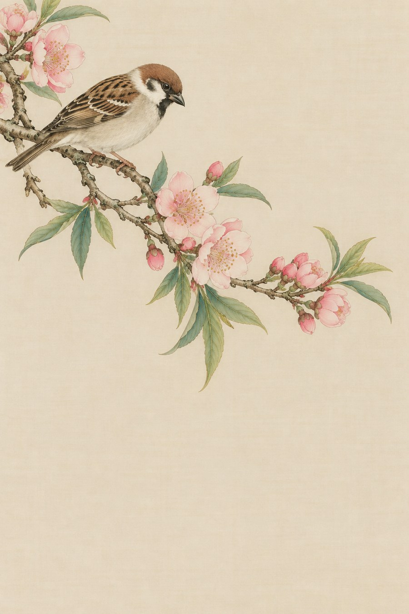
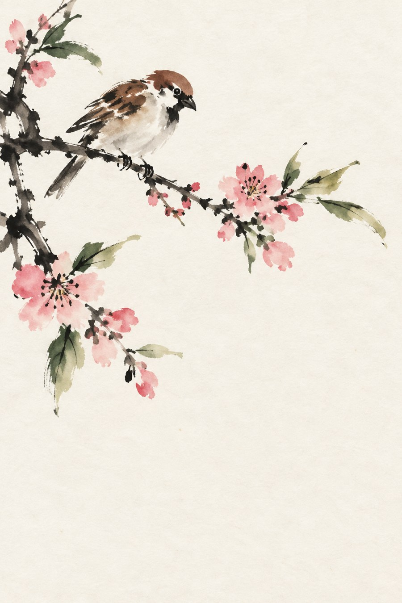
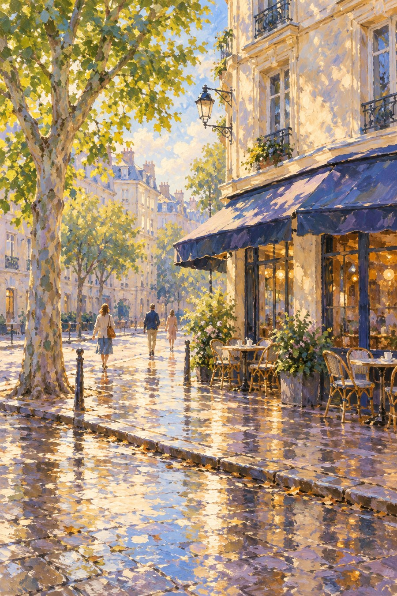
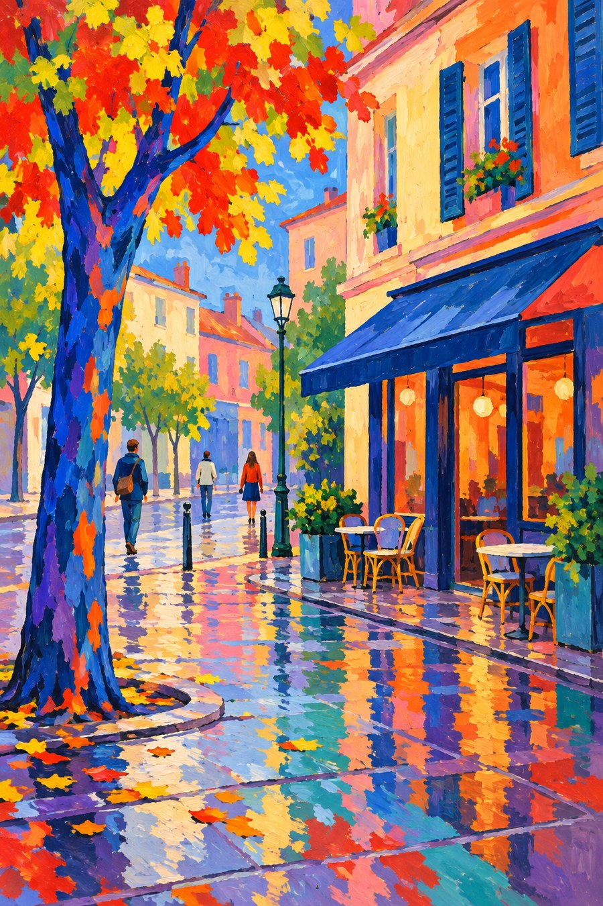
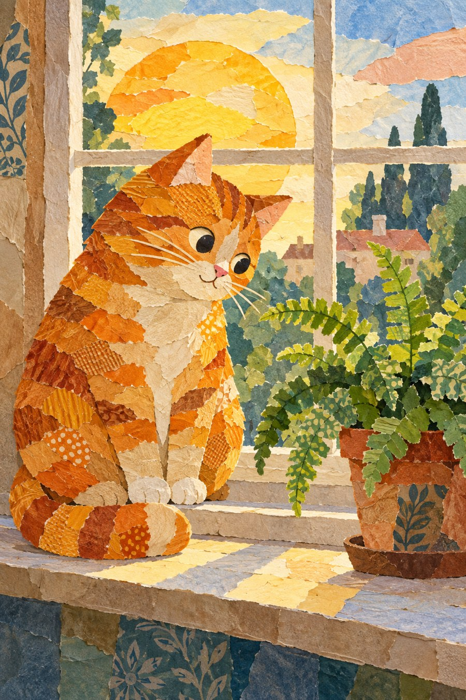
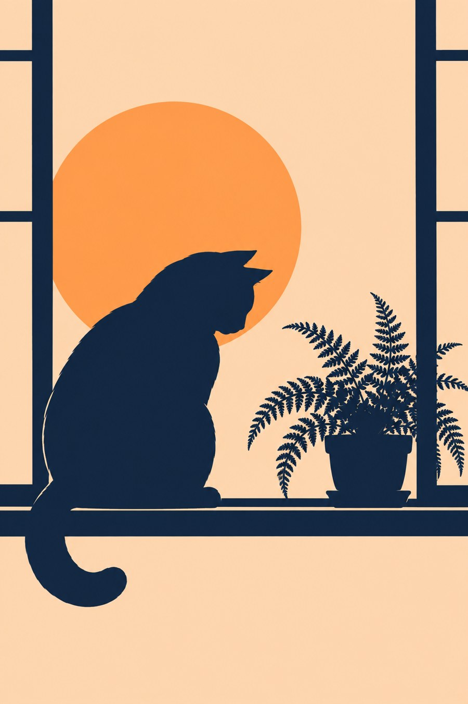

# 同题材实验室：再做八次比较

这些图保留主要对象，却没有完全锁定构图。先比较可见方法，再记录人物、位置、背景与细节的变化；这样更接近公平的判断。
## 1. 精细，还是一笔带过去？

| 工笔淡彩 | 写意淡彩 |
| --- | --- |
|  |  |

看麻雀羽片：前者分组与覆盖更清楚，后者把细节压缩到几次笔痕。花瓣从受约束的边界变成自由色块。两者都有大片空白，留白不是写意独占的特征。

**比较提醒：**不要把精细等同于更好。若故事需要耐心观看，细节可能有用；若需要快速抓住枝与鸟的生气，压缩更有力。

**小问题：**遮住标题后，只用两个可见线索描述差别。

## 2. 相近的街角，笔触还是色点？

| 印象主义启发 | 点彩 |
| --- | --- |
|  |  |

看树冠与墙面：前者短笔触大小和方向较多变，后者大量小点并置。远看都有光色与空间，近看构形单位不同。点彩图也有少数短痕与连续暗线，不能要求每一处都完美圆点。

**比较提醒：**不要把点彩理解成给印象图添加噪声。它尝试重新组织构形单位；在本书两图中，姿势与窗的位置也变化了，不属于笔触差别。

**小问题：**遮住标题后，只用两个可见线索描述差别。

## 3. 颜色在追随光，还是另起一套关系？

| 印象主义启发 | 野兽派启发 |
| --- | --- |
|  |  |

两张都鲜明，但野兽派示意出现蓝紫树干、红黄树冠与粉橙墙面，非自然色更主动。印象示意里的冷暖更像在描述日光和湿地反射。

**比较提醒：**这不是自然色与乱涂的二分。非自然色仍需组织面积、对比和焦点；印象主义也不只是客观记录。比较仅突出本组的颜色任务。

**小问题：**遮住标题后，只用两个可见线索描述差别。

## 4. 装饰像藤蔓，还是像阶梯？

| 新艺术方向 | 装饰艺术方向 |
| --- | --- |
|  |  |

前者以头发、花和曲线形成包围；后者以阶梯楼形、放射线与较规整结构建立秩序。都能装饰人物，观看节奏却不同。

**比较提醒：**曲线与几何只是便于入门的重点，不是历史之间绝对隔墙。新艺术也有几何，装饰艺术也有曲线；具体作品要具体看。

**小问题：**遮住标题后，只用两个可见线索描述差别。

## 5. 灰调是一片，还是一束？

| 石墨方向 | 墨线方向 |
| --- | --- |
|  |  |

石墨示意的船腹有连续深浅，墨线示意更多依靠线的密度和交错。后者天空留白较大；前者远景灰雾更多。

**比较提醒：**灯塔从左换到右是构图变化，不能解释为石墨和墨线的材料规律。想做严格实验，应该固定船与灯塔位置后再换调子方法。

**小问题：**遮住标题后，只用两个可见线索描述差别。

## 6. 细线能告诉我们工艺吗？

| 墨线方向 | 蚀刻方向 |
| --- | --- |
|  |  |

两张都能靠细排线表现木船。蚀刻示意增加暖纸、矩形版边与更多天空线痕，形成印刷暗示；墨线示意更显开阔。

**比较提醒：**不能只凭这一组确认真实制作。框线可画，纸色可模拟。视觉相似是本组最重要的发现：外观与材料并非一对一关系。

**小问题：**遮住标题后，只用两个可见线索描述差别。

## 7. 同一只猫，信息留在哪里？

| 剪纸拼贴 | 混合拼贴 | 剪影 |
| --- | --- | --- |
|  |  |  |

剪纸版把信息放在层叠和较统一色块；混合拼贴把信息放在异质纹样与撕边；剪影把信息转交给外轮廓和背景空隙。

**比较提醒：**比较时先问识别速度，再问近看趣味。细节更少的剪影并不必然贫乏，它需要外缘承担更大责任；复杂拼贴也不必然有更多故事。

**小问题：**遮住标题后，只用两个可见线索描述差别。

## 8. 同一束光，四种表面节奏

| 色粉方向 | 丙烯块面 | 蛋彩启发 | 喷笔式渐变 |
| --- | --- | --- | --- |
|  |  |  |  |

色粉先显颗粒与短痕，丙烯版先显宽块面，蛋彩启发版先显细痕，喷笔版先显连续过渡。四张都能解释圆面，所以不要把有体积误当作某个媒介专长。

**比较提醒：**喷笔版多出的梨叶与各图布褶变化属于内容干扰。屏幕不能确认真实颜料；此组比较的是可见构形与表面语言。

**小问题：**遮住标题后，只用两个可见线索描述差别。

## 最后，把结果写成一句话

“这两张都画了___，但一张主要靠___，另一张主要靠___；我还注意到___改变了，因此不能把它全部归因于画法。”

一个带有证据与边界的句子，已经比只猜名字更有用。
