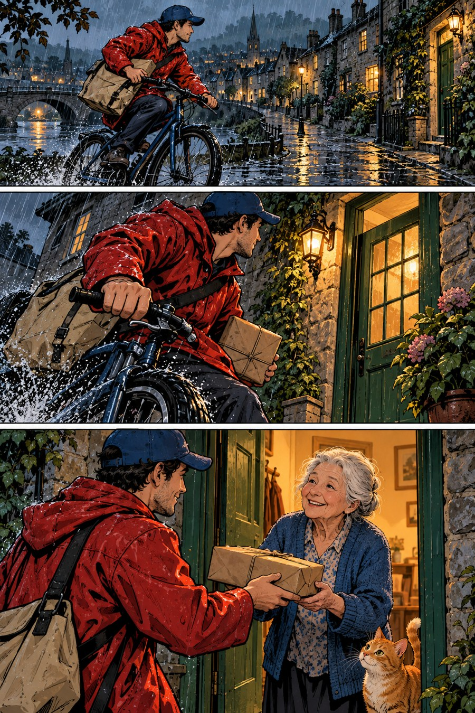

# 同一个雨天，三种讲故事的速度

故事只有三步：送书人在雨中骑行，来到绿门前，老人接到保持干燥的包裹。人物、衣服和主要事件近似保留，让我们比较的重点落到讲述方法上。

## 先把故事读完

清线方向版本把三格排得很整齐。红雨衣贯穿场景，交接动作完整。这张成图却有比严格清线预想更多的材质与阴影，所以它也展示了一次混合：轮廓易读，场景很丰富。

动作方向版本增加深黑和飞溅，第二格靠近车把与身体。你可能先感到天气，再理解送书。暖灯像任务的终点；它用强度改变感受，并没有改变故事的基本目的。

纵向版本先让小路展开，再把视线拉近手部，最后进入门口。白隙给中间动作留出停顿。它是一张短页，不是完整长篇滚动章节，但足够比较“读者什么时候看见下一件事”。

## 三张图怎样分配注意

| 观察项 | 清线方向成图 | 动作方向成图 | 纵向方向成图 |
| --- | --- | --- | --- |
| 第一眼 | 红衣与清楚的骑行 | 黑暗、雨势、近身动作 | 远景小路与目的地 |
| 中间一步 | 停在门口，定位明确 | 靠近手把，动势更强 | 手部近景，加白隙 |
| 结尾 | 包裹交接和老人表情 | 暖光与任务完成感 | 温暖笑脸与情绪停留 |
| 可能代价 | 环境细节有点多 | 强天气可能抢走日常温柔 | 空隙过长会打断联系 |

表格是对这三张示意的解读，不是给三个地区或平台下永久结论。它们都可以讲喜剧、悬疑或日常，真正决定效果的，是线、光、镜头与间隔怎样合作。

## 怎样做一个更公平的比较

这里不是完全控制变量：骑行方向、背景建筑、人物表情和包裹位置都有改变。因此，你不能把“这张老人更开心”全算成画风效果。更严谨的试验可以先画同一分镜草图，再仅改变轮廓、调子、着色和间距。

我们仍能学到一些东西，因为主要事件和服装有连续性。比较时给每个判断加上对象：“这张示意的暗部更强”，而不是“所有动作漫画都这样”。

## 编辑小游戏：只准留两格

如果只能保留两格，你会删哪格？如果主题是“送书完成”，骑行与交接通常足够；如果主题是“在雨中找到家”，抵达门口可能更重要。剪辑没有唯一答案，但必须让剩余图之间的因果能被理解。

再写一句你想让读者最后感到什么：松一口气、被关心、惊险结束，还是日常的温暖。回头看看哪张图的视觉重点最支持这个句子。你已经在做叙事设计了。
