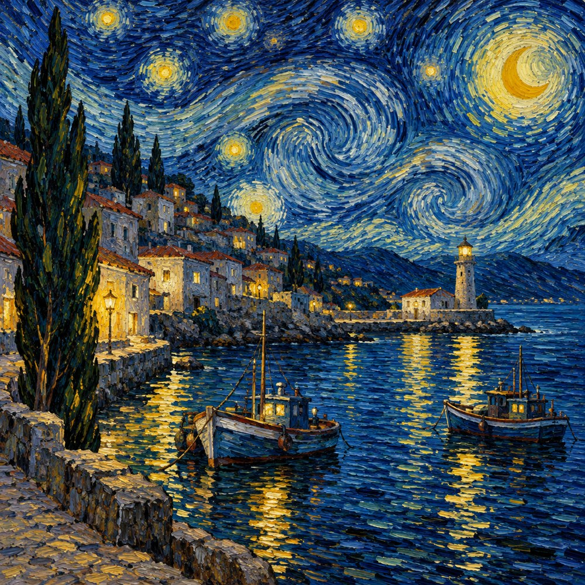
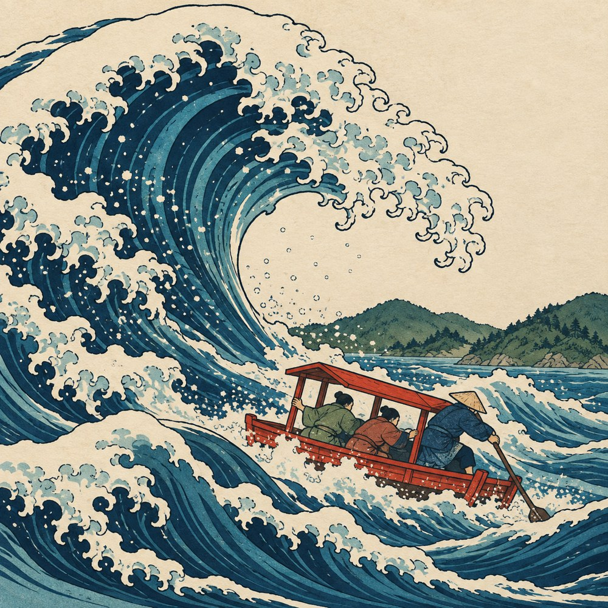
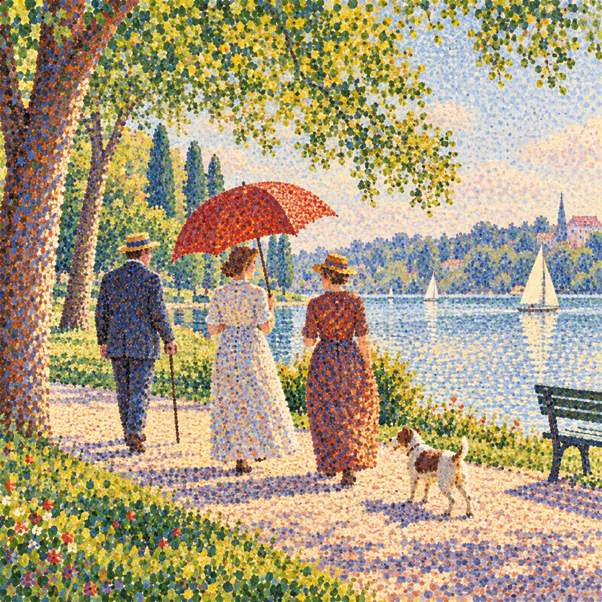
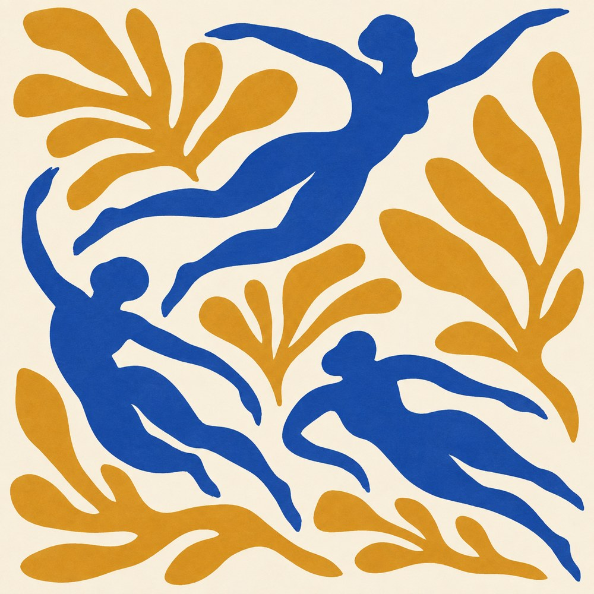

# 名画工作室：借方法，而不是只借一个名字

名画的价值不只是知名度。它们让我们看到某个视觉问题怎样被具体处理。本章采用“原作旁读—提取方法—改换题材—检查差别”的顺序。下面四张均为独立生成的新示意，不是原作照片、复制品或真迹。

## 1. 从《星夜》看笔触方向

梵高《星夜》作于 1889 年 6 月，馆方记录为油画。打开 MoMA 的作品页，看天空、水平方向的村庄与竖向树形怎样相遇。作品信息来自馆方；下面关于方向的提问是本书的观看建议。[S21](https://www.moma.org/collection/works/79802)

**提取的规则：**让不同区域使用不同走向的笔触，并用蓝黄关系连接夜空与灯光。我们改成港湾和渔船，保留方法，改变具体地点与构图。

**看成图：**天空绕星星旋转，水面横向铺开，房屋多用短痕。它们不是同一层“油画纹理”平均盖满，而是承担不同方向。若把天空纹理移到船身，物体转面可能被旋涡抢走。

**与本书厚涂人物比较：**人物图更强调皮肤、衣服与光，港湾图更强调跨区域节奏。它们都呈现油画感，说明媒介外观不能自动等同于一个作者或流派。

**成图边界：**天空旋涡、水面横痕与建筑短笔触有不同方向，蓝黄对比清楚；旋涡装饰感较强，不能据此声称复原梵高真实笔法或原作厚度。

**小实验：**不改颜色，只把水面也想成旋涡，整张图会更统一还是更混乱？参考判断：纹理可能统一，但港湾的水平稳定与天空的旋动对照会减弱。统一并非总是目标。

## 2. 从《神奈川冲浪里》看尺度与空隙

The Met 所藏北斋《神奈川冲浪里》记录年代约 1830—1832 年，媒介为纸上墨与色的木版。先在原作链接里找浪峰、小船与远处富士山，不要只看著名的浪尖。[S22](https://www.metmuseum.org/art/collection/search/45434)

**提取的规则：**大曲线压向小船，远景降低存在感，中间留出可被感到的空隙。示意改为河中渡船与低山，红色小船成为新的局部焦点。

**看成图：**浪的蓝色带和白泡沫形成重复，浪峰围出的浅色区域比很多细节更影响张力。小船的倾斜加强危险感；这属于构图与叙事安排，不是木版材料必然造成的情绪。

**与本书河岸人物比较：**同样借木版轮廓和平面颜色，前者的观看较平稳，这张则由尺度和倾斜制造压力。题材改变了，工艺方向仍可能相近。

**成图边界：**浪峰、小船和远山的尺度关系清楚，轮廓与平面色带明显；青蓝区仍有模拟渐变与纹理，部分色块不严格对应独立印版。

**小实验：**把渡船想象成大到占据画面一半，威胁感是否仍一样？参考判断：人和浪的比例关系改变，巨浪压住人的感觉会减弱；焦点也从环境移向船。

## 3. 从修拉看颜色怎样组成一个人

芝加哥艺术博物馆的《大碗岛》研究专题提供原作和制作研究入口。这里用它理解小色点与整体形体的关系，不把公园、伞或侧面人物本身当成点彩的定义。[S23](https://archive.artic.edu/seurat/seurat_overview.html) 点彩与更广的分色实践之间的区分另见 The Met。[S12](https://www.metmuseum.org/essays/georges-seurat-1859-1891-and-neo-impressionism)

**提取的规则：**让人体、地面、湖水与树叶都由相邻色点构形，而不是只给平滑照片撒噪声。新场景换成三位走路的人、一把红伞和一只狗。

**看成图：**伞是最容易远看成整块的区域，近看又由红橙与亮点组成；白衣含冷暖小痕，不能简单说成“一块白”。树冠的密点与湖面的疏亮对照，还帮助区分材质和位置。

**与本书点彩街角比较：**街角依靠建筑边和透视保持识别，新图让衣服与人体也更多交给色点。比较的重点是构形任务，不能因为人物看起来像旧时代就自动确认艺术史归属。

**成图边界：**大部分人物和树叶由小点及短小色痕构形，近远尺度差明显；局部仍是较大的斑点或短痕，不是全图完全一致的圆点。

**小实验：**把红伞区域单独遮住，第一眼会先停哪里？参考判断：焦点可能转到暗衣或树干；颜色面积与明暗共同组织注意，不是所有点都同等重要。

## 4. 从马蒂斯看白缝怎样画身体

MoMA 的《蓝色裸体 II》资料记录了 1952 年 gouache 彩纸剪贴作品，并说明剪形与绘画研究之间的往返。它帮助我们避免把简洁等同于没有准备。[S24](https://www.moma.org/audio/playlist/6/316)

**提取的规则：**让外缘、肢体之间的白缝和颜色面积承担形体；不使用内部肌肉阴影。示意换成三位游泳者和叶形，远离原作的坐姿布局。

**看成图：**上方人物两臂展开，中下方身体斜向交织；白色把腿与躯干分开，也让赭色叶片有呼吸空间。这里白不是尚未填满的背景，而是参与组织的形状。

**与本书剪纸猫比较：**猫的层叠有厚度提示，这张更接近平面剪形。两者共享剪口语言，却把不同任务交给了边缘：一张讲层次，一张讲人体与负形。

**成图边界：**三个人体与赭色叶形保持平面，白缝承担关节与形体关系；有细微纸面颗粒，不能把它当作马蒂斯真实剪贴的记录。

**小实验：**挑一条白缝，把它想象成被蓝色填平，哪个肢体最先难认？参考判断：腿与躯干相接的空隙常特别重要；删一条白缝比增加十条肌肉线更能改变形体。

## 如何写一份有用的名画参考

不要只写“像梵高”。可以写：“参考《星夜》的区域笔触方向和蓝黄关系，改为港湾题材；不复制村庄布局，不把作者名字当作真实性声明。”作品信息有来源，可见方法有具体位置，改变的内容也清楚。

借鉴的每一步都能被检查，参考才成为学习工具。它没有要求你把生成图当成原作，更不要求原作符合本书的简化模板。
