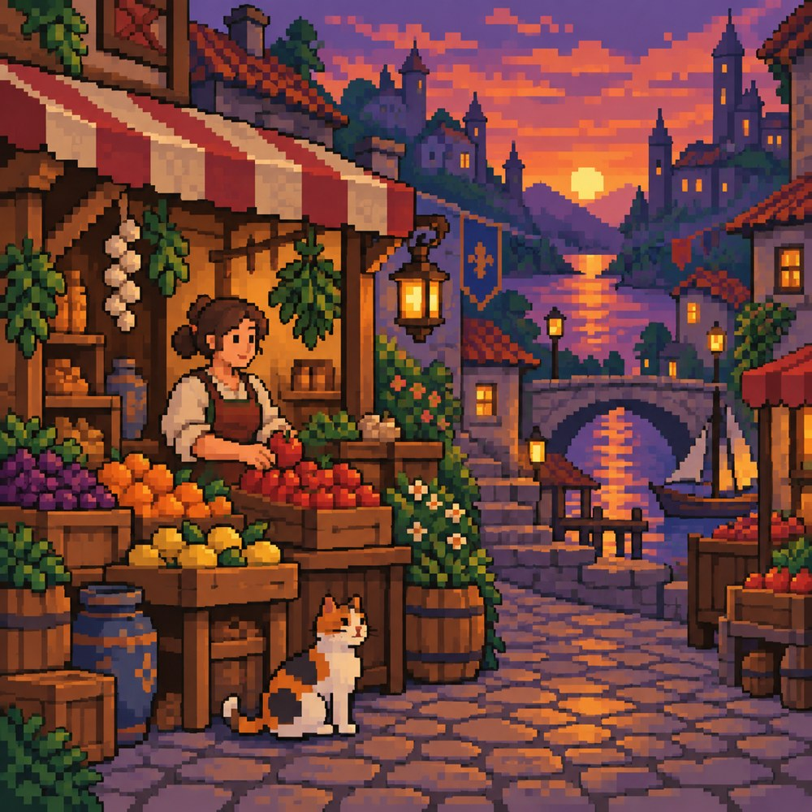
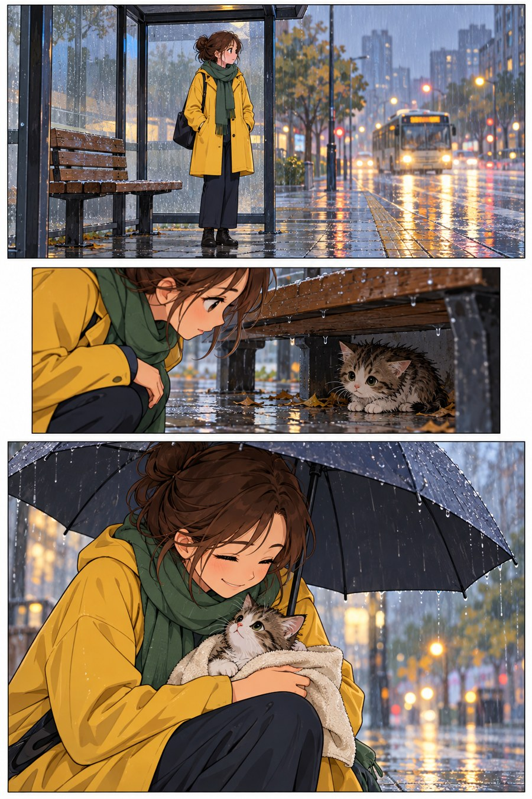

# 流行视觉工作室：看它怎样工作，不靠排行榜

本章选的是有公开资料、便于旁读的视觉实践，不宣称它们是今天最热门的榜单。动画、游戏、网络漫画和印刷海报有各自的用途；相似外观并不意味着来源完全相同。

## 1. 动画方向：同一个角色需要怎样的阴影规则

V&A 的《French Windows》资料给出透明片与 gouache 叠放的动画案例。它是具体历史参照，不是新图故事的原型，也不代表所有动画都采用同一工艺。[S25](https://www.vam.ac.uk/articles/french-windows-the-psychedelic-music-video-for-pink-floyds-one-of-these-days)

新图里，橙色外套、绿色头盔、黑色背包带让角色易认，外套和裤子的阴影边界也相对清楚。与最初蓝裙人物相比，职业道具与交换动作承担更多故事信息。

**再看一个反例：**背景和面包偏细腻，脸部也不完全平涂。画面好看与严格兑现“两档阴影”是两种评价。若要真正用作多帧角色参考，还需让每帧遵守相同规则。

**成图边界：**外套和裤子有明确分区阴影，人物轮廓易读；背景和面包更细腻，脸部也有柔和过渡，并非全画严格两档平涂，另新增了面包师角色。

**小实验：**把外套想成四十种细渐变，再让人物连续跑三帧。你需要追踪的信息会怎样变化？参考判断：阴影形状与过渡需要更多控制；但少档并不自动意味着动画容易，角色造型与动作仍须一致。

## 2. 游戏方向：像素、插画与三维可以同场出现

Nintendo 的《Mario & Luigi: Dream Team Bros.》开发访谈讨论了不同方向像素角色，并记录像素、多边形与插画版本并存。它是开发者对一个具体项目的说明，不能推广成所有游戏的标准流程。[S27](https://www.nintendo.com/en-za/Iwata-Asks/Iwata-Asks-Mario-Luigi-Dream-Team-Bros-/Mario-Luigi-Dream-Team-Bros-/2-Pixel-Artists/2-Pixel-Artists-778636.html)

新图把像素感用于完整街景：屋顶斜边形成阶梯，灯笼用小色块聚合，猫的耳和尾巴在很少形状中可认。它与本书早期像素人物共同说明，题材可以变化，离散构形问题仍在。

**注意一个没有完全成功的目标：**图中天空有较平滑的色调，局部方块尺度并不一致，远超过提示中的十六色。它适合学习像素感，不适合直接声称“统一网格、限色十六种”的生产资产。

**成图边界：**阶梯边、人物与猫的像素簇明显；天空仍有平滑调子，局部方块尺度和边缘不一致，颜色远多于16种。是像素风模拟，不是可直接交付游戏的严格像素资产。

**小实验：**如果把猫的耳尖抹成柔边，识别未必完全消失，但与邻近阶梯边的规则会不一致。局部精致不一定增加整体可信度。

## 3. 网络漫画方向：相同题材之外，还能比较节奏

WEBTOON 官方手册对纵向格式、间距和小屏阅读有具体指导。这是平台提供的格式建议，不是所有漫画应遵守的永久法规。[S20](https://webtoons-static.pstatic.net/creator101/fr/pdf/Creator-Handbook.pdf?dt=2024011501)

第一格交代雨与候车地点，第二格把注意移到长凳下，第三格放大人与猫的关系。与送书故事相比，目标不再是顺利交付物件，而是一次发现之后的关心。分格的功能也随之改变。

**观察镜头而不是只看柔光：**第二格缩进，第三格面积更大，读者会在结尾停留更多。然而实际白隙比大间隔设想更短，背景又很细腻，因此这一页仍偏插画分格的混合方向。

**成图边界：**等待、发现和保护的三个事件清楚，最后一格面积最大；白隙仍偏短，背景摄影式光影很多，也增加了毛巾道具，未完全兑现简洁平涂和大间距的设想。

**小实验：**删掉第二格，女孩抱猫的结尾还温暖吗？可能仍温暖，但“发现”的转折消失，故事更像一张已完成的关系照。缺失的是事件，不只是节奏。

## 4. 印刷海报方向：限色比纸纹更值得检查

RISO 官方说明把艺术使用与数字孔版技术联系起来。[S6](https://www.riso.co.jp/english/company/risoart/concept.html) 本章新图是原创建议中的社区换书场景，不是某个真实活动的已印海报。

人物、书和花盆保持较平的色面，交换中的蓝书被两侧珊瑚色手臂夹住。与早期书店图相比，颜色更集中，留白更大，重点从室内细节转向交换动作。

**最值得核对的不是“颗粒好不好看”：**若用于实际制作，是否有独立颜色层、叠印关系和纸张记录？当前示意没有真实分版文件，不能仅因出现紫色就宣布实现了物理叠印。

**成图边界：**蓝、珊瑚与局部紫的配色集中，颗粒和平面角色明显，交换动作是焦点；从生成图不能证明真实两色印版或紫色确为物理叠印。

**小实验：**保留所有纸纹，改成二十种相互独立的颜色，它还会有同样的限色逻辑吗？参考判断：可能仍有印刷质感，但颜色约束已经改变；质感与生产规则需要分别评价。

## 参考流行内容时，写出三个层次

| 层次 | 示例 | 需要的证据 |
| --- | --- | --- |
| 真实参照 | 某款游戏的官方开发访谈 | 项目与作者资料 |
| 提取的方法 | 多方向像素角色、格式与节奏 | 能定位的说明或图像线索 |
| 新的应用 | 本书集市或公交站故事 | 当前成图的观察与偏差记录 |

这样既能使用熟悉的内容，也不会把“喜欢某款游戏”误写成“所有像素艺术都源于它”。流行参照帮助读者进入问题，问题仍需要自己看图回答。
